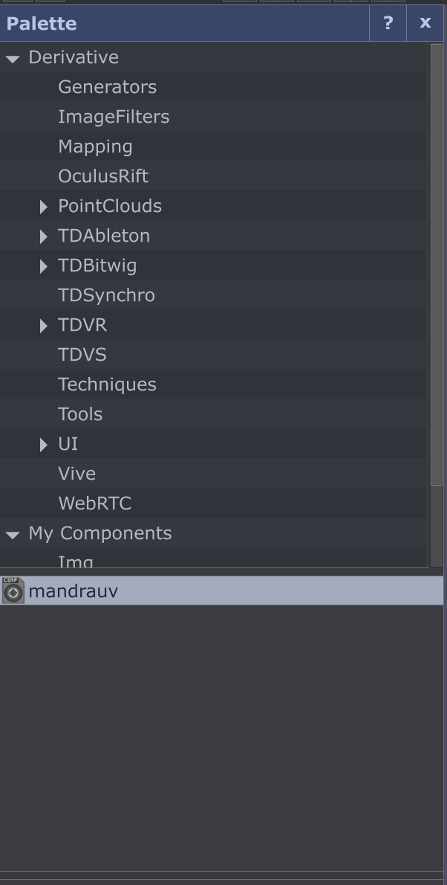
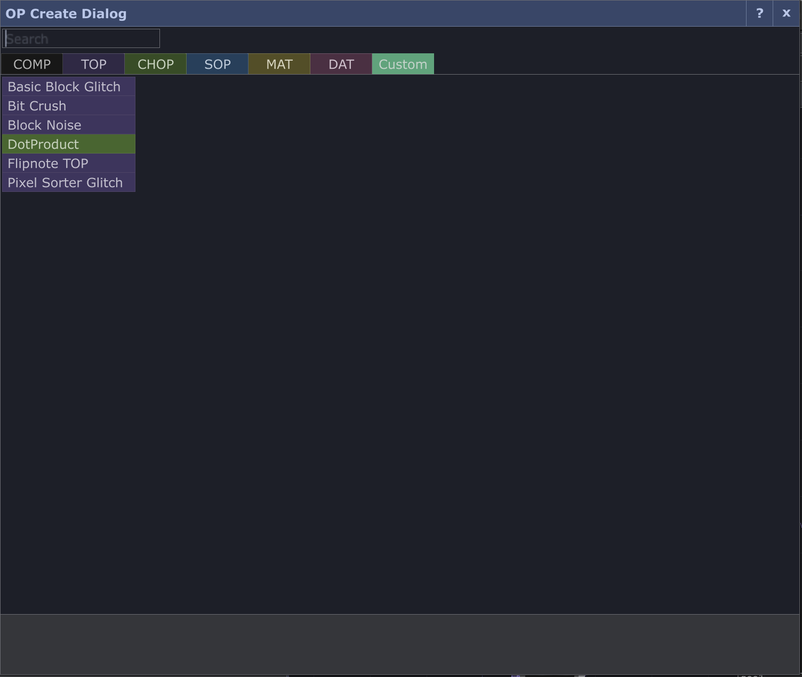
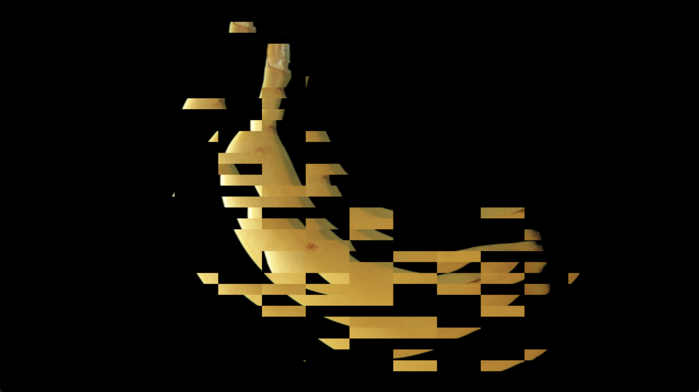
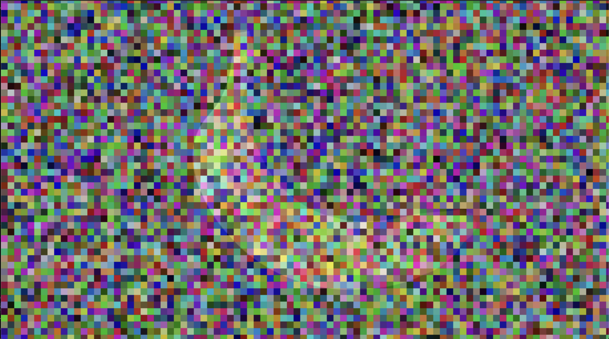
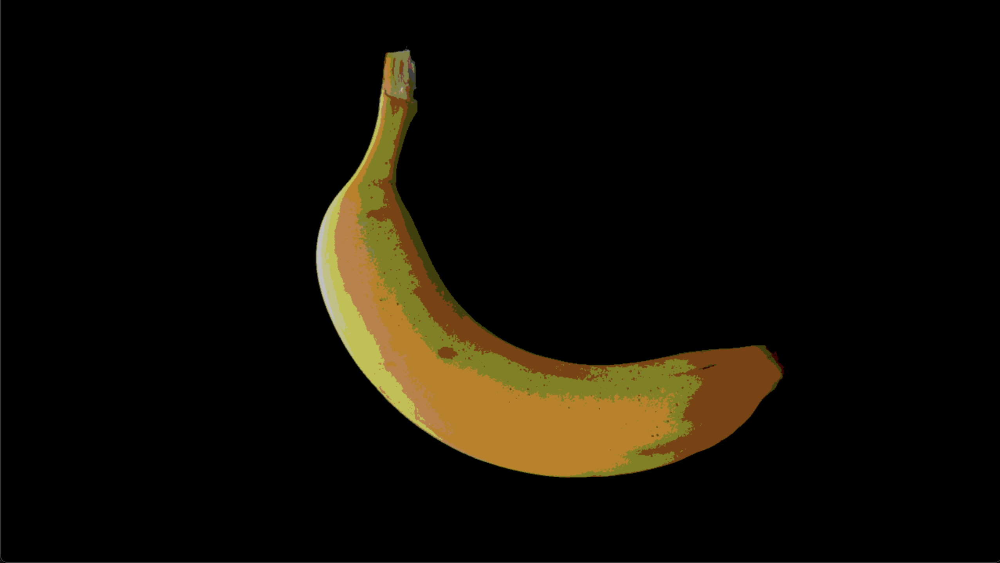
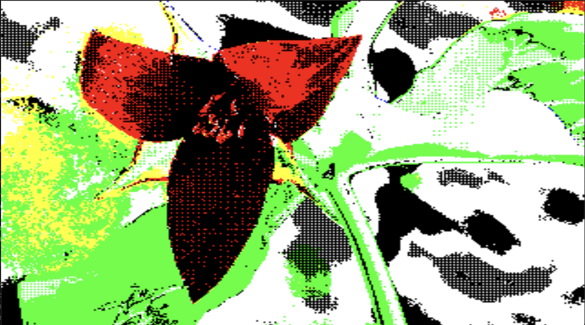
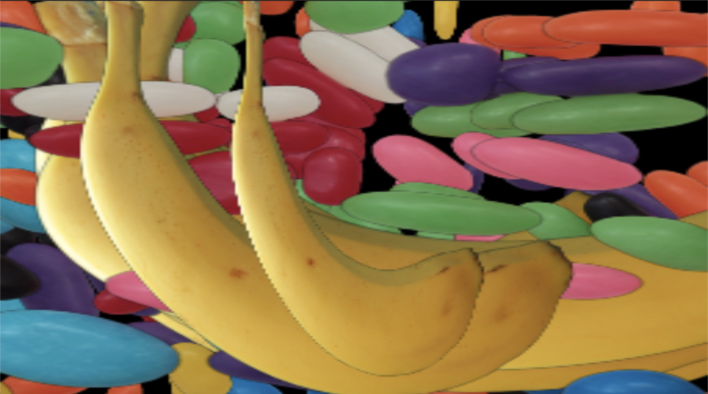

[日本語](./README.md) | English

# TouchDesigner Plugins  
This section contains custom additional features for TouchDesigner.  

**Downloads, descriptions and parameter references for the plugins are on the site → [TouchDesigner Plugins](https://shinh0707.github.io/TouchDesignerShareDatas/)** (Japanese)  
- [Palette](#palette)  
- [Plugin](#plugin)  
    - [Installation](#plugin-installation)  
    - [Description](#plugin-description)  
        - [CHOP](#chop)
        - [TOP](#top)
  
## Palette  
This is like the presets found in the left tab of TouchDesigner.  
  
  
<!-- tdp:palettes:begin (tools/palettes.py) -->
Descriptions, parameters, examples and required plugins are on the [palette list on the site](https://shinh0707.github.io/TouchDesignerShareDatas/palettes/) (Japanese). Drag a `.tox` into your network to use it. *For details, please refer to [https://derivative.ca/UserGuide/Palette](https://derivative.ca/UserGuide/Palette)*

- [AudioQuantizeRate](Palettes/Audio/Feature/AudioQuantizeRate.tox) — オーディオが Q ビットの段（±1 を 2^Q − 1 段に分けた格子）にどれだけ乗っているか（ビットクラッシュ・ローフ… ([説明](https://shinh0707.github.io/TouchDesignerShareDatas/palettes/Audio/Feature/AudioQuantizeRate/), [使用例](Palettes/Audio/Feature/AudioQuantizeRateExample.toe))
- [CrestFactor](Palettes/Audio/Feature/CrestFactor.tox) — クレストファクター（ピーク ÷ RMS）。音のとがり具合（打撃音ほど大きく、正弦波で √2 ≈ 1.41、矩形波で 1）… ([説明](https://shinh0707.github.io/TouchDesignerShareDatas/palettes/Audio/Feature/CrestFactor/), [使用例](Palettes/Audio/Feature/CrestFactorExample.toe))
- [RMSNorm](Palettes/Audio/Feature/RMSNorm.tox) — RMS で割って大きさをそろえる（x / RMS(x)）。音量によらない波形の形を比べたいときに使う。   ([説明](https://shinh0707.github.io/TouchDesignerShareDatas/palettes/Audio/Feature/RMSNorm/), [使用例](Palettes/Audio/Feature/RMSNormExample.toe))
- [VU](Palettes/Audio/Feature/VU.tox) — VU メーター。整流した信号を 2 次のフィルタ（減衰比 Dump、固有角周波数 Angf：VU 規格の約 300 ms… ([説明](https://shinh0707.github.io/TouchDesignerShareDatas/palettes/Audio/Feature/VU/), [使用例](Palettes/Audio/Feature/VUExample.toe))
- [ZCR](Palettes/Audio/Feature/ZCR.tox) — ゼロ交差率（隣り合うサンプルで符号が変わる割合）。ノイズや高い音ほど大きく、低い音ほど小さい。   ([説明](https://shinh0707.github.io/TouchDesignerShareDatas/palettes/Audio/Feature/ZCR/), [使用例](Palettes/Audio/Feature/ZCRExample.toe))
- [F0](Palettes/Audio/Pitch/F0.tox) — 基本周波数（音の高さ）を Hz で推定する。参照したスペクトルの上で、Fmin〜Fmax の候補ごとに、その 1〜12 … ([説明](https://shinh0707.github.io/TouchDesignerShareDatas/palettes/Audio/Pitch/F0/), [使用例](Palettes/Audio/Pitch/F0Example.toe))
- [F0Note](Palettes/Audio/Pitch/F0Note.tox) — F0 で推定した音の高さを、整数の MIDI ノート番号で出す（F0 → F0ToNote → 四捨五入）。   ([説明](https://shinh0707.github.io/TouchDesignerShareDatas/palettes/Audio/Pitch/F0Note/), [使用例](Palettes/Audio/Pitch/F0NoteExample.toe))
- [F0ToNote](Palettes/Audio/Pitch/F0ToNote.tox) — 周波数 Hz を MIDI ノート番号（小数）に変換する: 69 + 12·log2(f / 440)。A4 = 440… ([説明](https://shinh0707.github.io/TouchDesignerShareDatas/palettes/Audio/Pitch/F0ToNote/), [使用例](Palettes/Audio/Pitch/F0ToNoteExample.toe))
- [NumToNoteTrigger](Palettes/Audio/Pitch/NumToNoteTrigger.tox) — ノート番号を 128 サンプルのワンホットに変換する。入力のノート番号と ±0.01 以内のインデックスだけが 1、ほか… ([説明](https://shinh0707.github.io/TouchDesignerShareDatas/palettes/Audio/Pitch/NumToNoteTrigger/), [使用例](Palettes/Audio/Pitch/NumToNoteTriggerExample.toe))
- [PSGRatio](Palettes/Audio/Pitch/PSGRatio.tox) — 倍音のうち奇数次の占める割合（矩形波・PSG らしさ）。F0 を推定し、スペクトルの各ビンが何次の倍音に近いかを求めて、… ([説明](https://shinh0707.github.io/TouchDesignerShareDatas/palettes/Audio/Pitch/PSGRatio/), [使用例](Palettes/Audio/Pitch/PSGRatioExample.toe))
- [BaseAudioSpect](Palettes/Audio/Spectrum/BaseAudioSpect.tox) — オーディオ CHOP を Audio Spectrum CHOP でスペクトルに変換する土台。ほかの AudioSpec… ([説明](https://shinh0707.github.io/TouchDesignerShareDatas/palettes/Audio/Spectrum/BaseAudioSpect/), [使用例](Palettes/Audio/Spectrum/BaseAudioSpectExample.toe))
- [BinFrequency](Palettes/Audio/Spectrum/BinFrequency.tox) — スペクトルの各ビンの中心周波数 f_k = k · fs / N（Hz）を、スペクトルと同じ長さのチャンネルで出す。fs… ([説明](https://shinh0707.github.io/TouchDesignerShareDatas/palettes/Audio/Spectrum/BinFrequency/), [使用例](Palettes/Audio/Spectrum/BinFrequencyExample.toe))
- [FFTSize](Palettes/Audio/Spectrum/FFTSize.tox) — 参照した Audio Spectrum CHOP の FFT サイズ N（= 2^(fftsize+6)）を定数で出す。… ([説明](https://shinh0707.github.io/TouchDesignerShareDatas/palettes/Audio/Spectrum/FFTSize/), [使用例](Palettes/Audio/Spectrum/FFTSizeExample.toe))
- [LogBinFrequency](Palettes/Audio/Spectrum/LogBinFrequency.tox) — ビン周波数を対数（オクターブ）軸に変換した x_k = log2(f_k) を出す。log2 の前に f_k を Fcl… ([説明](https://shinh0707.github.io/TouchDesignerShareDatas/palettes/Audio/Spectrum/LogBinFrequency/), [使用例](Palettes/Audio/Spectrum/LogBinFrequencyExample.toe))
- [LogRemap](Palettes/Audio/Spectrum/LogRemap.tox) — サンプルの横軸を対数にとり直す（等間隔の周波数ビン → 対数の周波数軸）。出力の横位置 t (0〜1) が元の列の位置 … ([説明](https://shinh0707.github.io/TouchDesignerShareDatas/palettes/Audio/Spectrum/LogRemap/), [使用例](Palettes/Audio/Spectrum/LogRemapExample.toe))
- [MagnitudeDb](Palettes/Audio/Spectrum/MagnitudeDb.tox) — スペクトル振幅をデシベル y_k = 20·log10(|X_k|) に変換する。振幅は 0.001 で下限クランプ（-… ([説明](https://shinh0707.github.io/TouchDesignerShareDatas/palettes/Audio/Spectrum/MagnitudeDb/), [使用例](Palettes/Audio/Spectrum/MagnitudeDbExample.toe))
- [PowerSpectrum](Palettes/Audio/Spectrum/PowerSpectrum.tox) — 各サンプルの 2 乗 |x|²（振幅スペクトル → パワースペクトル）。   ([説明](https://shinh0707.github.io/TouchDesignerShareDatas/palettes/Audio/Spectrum/PowerSpectrum/), [使用例](Palettes/Audio/Spectrum/PowerSpectrumExample.toe))
- [SpectralCentroid](Palettes/Audio/Spectrum/SpectralCentroid.tox) — スペクトル重心（明るさの指標）を Hz で出す。重心 = Σ E_k f_k / Σ E_k、E_k = |X_k|²。… ([説明](https://shinh0707.github.io/TouchDesignerShareDatas/palettes/Audio/Spectrum/SpectralCentroid/), [使用例](Palettes/Audio/Spectrum/SpectralCentroidExample.toe))
- [SpectralCentroidNorm](Palettes/Audio/Spectrum/SpectralCentroidNorm.tox) — スペクトル重心をナイキスト周波数で割って 0〜1 に正規化したもの: (Σ E_k f_k / Σ E_k) / (fs… ([説明](https://shinh0707.github.io/TouchDesignerShareDatas/palettes/Audio/Spectrum/SpectralCentroidNorm/), [使用例](Palettes/Audio/Spectrum/SpectralCentroidNormExample.toe))
- [SpectralFlatness](Palettes/Audio/Spectrum/SpectralFlatness.tox) — スペクトル平坦度（ノイズらしさ）。エネルギー E_k = |X_k|² の幾何平均 ÷ 算術平均で、0（純音・音程感が強… ([説明](https://shinh0707.github.io/TouchDesignerShareDatas/palettes/Audio/Spectrum/SpectralFlatness/), [使用例](Palettes/Audio/Spectrum/SpectralFlatnessExample.toe))
- [SpectralFlux](Palettes/Audio/Spectrum/SpectralFlux.tox) — スペクトルフラックス（立ち上がり・オンセットの強さ）。前フレームからの増加分だけを二乗して合計: Σ max(0, X_… ([説明](https://shinh0707.github.io/TouchDesignerShareDatas/palettes/Audio/Spectrum/SpectralFlux/), [使用例](Palettes/Audio/Spectrum/SpectralFluxExample.toe))
- [SpectralSlope](Palettes/Audio/Spectrum/SpectralSlope.tox) — スペクトル傾斜。横軸 log2(f)（xk）、縦軸 dB（yk）の最小二乗直線の傾きを dB/オクターブで出す。負に大き… ([説明](https://shinh0707.github.io/TouchDesignerShareDatas/palettes/Audio/Spectrum/SpectralSlope/), [使用例](Palettes/Audio/Spectrum/SpectralSlopeExample.toe))
- [3DSphereMap](Palettes/Audio/Stereo/3DSphereMap.tox) — ステレオ信号を 3D の点列にする（ゴニオメーターの 3D 版）。各サンプルを、z = 区間内の位置（−1〜1）、y =… ([説明](https://shinh0707.github.io/TouchDesignerShareDatas/palettes/Audio/Stereo/3DSphereMap/), [使用例](Palettes/Audio/Stereo/3DSphereMapExample.toe))
- [MultiChannelPreTrail](Palettes/Audio/Stereo/MultiChannelPreTrail.tox) — タイムスライスの全サンプルを、1 サンプルずつ別のチャンネルに並べ替える（Shuffle: チャンネルとサンプルを入れ替… ([説明](https://shinh0707.github.io/TouchDesignerShareDatas/palettes/Audio/Stereo/MultiChannelPreTrail/), [使用例](Palettes/Audio/Stereo/MultiChannelPreTrailExample.toe))
- [PanAngle](Palettes/Audio/Stereo/PanAngle.tox) — ステレオ信号の定位（左右どちらに寄っているか）を −1〜1 で出す。左右の RMS の角度 atan2(L, R)（0°… ([説明](https://shinh0707.github.io/TouchDesignerShareDatas/palettes/Audio/Stereo/PanAngle/), [使用例](Palettes/Audio/Stereo/PanAngleExample.toe))
- [PanAngleStereo](Palettes/Audio/Stereo/PanAngleStereo.tox) — PanAngle の、L と R を別々の CHOP で受ける版。2 つのモノラル信号のどちらが大きいかを −1〜1 で… ([説明](https://shinh0707.github.io/TouchDesignerShareDatas/palettes/Audio/Stereo/PanAngleStereo/), [使用例](Palettes/Audio/Stereo/PanAngleStereoExample.toe))
- [PhaseCorrelation](Palettes/Audio/Stereo/PhaseCorrelation.tox) — 位相相関計（コリレーションメーター）。左右がどれだけ同じ形かを −1〜1 で出す: Σ L·R / √(Σ L² · Σ… ([説明](https://shinh0707.github.io/TouchDesignerShareDatas/palettes/Audio/Stereo/PhaseCorrelation/), [使用例](Palettes/Audio/Stereo/PhaseCorrelationExample.toe))
- [StereoWidth](Palettes/Audio/Stereo/StereoWidth.tox) — ステレオの広がり。Side（L−R）と Mid（L+R）のエネルギーから ΣS² / (ΣS² + ΣM²) を出す。0… ([説明](https://shinh0707.github.io/TouchDesignerShareDatas/palettes/Audio/Stereo/StereoWidth/), [使用例](Palettes/Audio/Stereo/StereoWidthExample.toe))
- [DLeakyReLU](Palettes/AutoDiff/Activation/DLeakyReLU.tox) — AutoDiff（CHOP で組んだ自動微分）の部品。Leaky ReLU y = x（x > 0）/ Slope · … ([説明](https://shinh0707.github.io/TouchDesignerShareDatas/palettes/AutoDiff/Activation/DLeakyReLU/), [使用例](Palettes/AutoDiff/Activation/DLeakyReLUExample.toe))
- [DSigmoid](Palettes/AutoDiff/Activation/DSigmoid.tox) — AutoDiff（CHOP で組んだ自動微分）の部品。シグモイド y = 1 / (1 + e^(−Gain·x))。D… ([説明](https://shinh0707.github.io/TouchDesignerShareDatas/palettes/AutoDiff/Activation/DSigmoid/), [使用例](Palettes/AutoDiff/Activation/DSigmoidExample.toe))
- [DSoftmax](Palettes/AutoDiff/Activation/DSoftmax.tox) — AutoDiff（CHOP で組んだ自動微分）の部品。ソフトマックス y = softmax(x / Tempature… ([説明](https://shinh0707.github.io/TouchDesignerShareDatas/palettes/AutoDiff/Activation/DSoftmax/), [使用例](Palettes/AutoDiff/Activation/DSoftmaxExample.toe))
- [DBetaMode](Palettes/AutoDiff/BetaDist/DBetaMode.tox) — AutoDiff（CHOP で組んだ自動微分）の部品。ベータ分布 Beta(a, b) の最頻値 y = (a − 1)… ([説明](https://shinh0707.github.io/TouchDesignerShareDatas/palettes/AutoDiff/BetaDist/DBetaMode/), [使用例](Palettes/AutoDiff/BetaDist/DBetaModeExample.toe))
- [DBetaModeLL](Palettes/AutoDiff/BetaDist/DBetaModeLL.tox) — AutoDiff（CHOP で組んだ自動微分）の部品。ベータ分布 Beta(a, b) の最頻値での確率密度の対数（ピー… ([説明](https://shinh0707.github.io/TouchDesignerShareDatas/palettes/AutoDiff/BetaDist/DBetaModeLL/), [使用例](Palettes/AutoDiff/BetaDist/DBetaModeLLExample.toe))
- [DAdd](Palettes/AutoDiff/DAdd.tox) — AutoDiff（CHOP で組んだ自動微分）の部品。足し算 y = a + b。D1 に「out1 についての損失の勾… ([説明](https://shinh0707.github.io/TouchDesignerShareDatas/palettes/AutoDiff/DAdd/), [使用例](Palettes/AutoDiff/DAddExample.toe))
- [DDiv](Palettes/AutoDiff/DDiv.tox) — AutoDiff（CHOP で組んだ自動微分）の部品。割り算 y = a / b。D1 に「out1 についての損失の勾… ([説明](https://shinh0707.github.io/TouchDesignerShareDatas/palettes/AutoDiff/DDiv/), [使用例](Palettes/AutoDiff/DDivExample.toe))
- [DDot](Palettes/AutoDiff/DDot.tox) — AutoDiff（CHOP で組んだ自動微分）の部品。行列の積 Y = A · B（チャンネルが行、サンプルが列）。D1… ([説明](https://shinh0707.github.io/TouchDesignerShareDatas/palettes/AutoDiff/DDot/), [使用例](Palettes/AutoDiff/DDotExample.toe))
- [DMul](Palettes/AutoDiff/DMul.tox) — AutoDiff（CHOP で組んだ自動微分）の部品。掛け算（要素ごと）y = a · b。D1 に「out1 について… ([説明](https://shinh0707.github.io/TouchDesignerShareDatas/palettes/AutoDiff/DMul/), [使用例](Palettes/AutoDiff/DMulExample.toe))
- [DPow](Palettes/AutoDiff/DPow.tox) — AutoDiff（CHOP で組んだ自動微分）の部品。べき乗 y = aᵇ。D1 に「out1 についての損失の勾配 d… ([説明](https://shinh0707.github.io/TouchDesignerShareDatas/palettes/AutoDiff/DPow/), [使用例](Palettes/AutoDiff/DPowExample.toe))
- [DSign](Palettes/AutoDiff/DSign.tox) — AutoDiff（CHOP で組んだ自動微分）の部品。符号 y = sign(x)（−1 / 0 / 1）。D1 に「o… ([説明](https://shinh0707.github.io/TouchDesignerShareDatas/palettes/AutoDiff/DSign/), [使用例](Palettes/AutoDiff/DSignExample.toe))
- [DSquaredDiff](Palettes/AutoDiff/DSquaredDiff.tox) — AutoDiff（CHOP で組んだ自動微分）の部品。要素ごとの差の 2 乗 y = (a − b)²。D1 に「out… ([説明](https://shinh0707.github.io/TouchDesignerShareDatas/palettes/AutoDiff/DSquaredDiff/), [使用例](Palettes/AutoDiff/DSquaredDiffExample.toe))
- [DSub](Palettes/AutoDiff/DSub.tox) — AutoDiff（CHOP で組んだ自動微分）の部品。引き算 y = a − b。D1 に「out1 についての損失の勾… ([説明](https://shinh0707.github.io/TouchDesignerShareDatas/palettes/AutoDiff/DSub/), [使用例](Palettes/AutoDiff/DSubExample.toe))
- [DAbs](Palettes/AutoDiff/Function/DAbs.tox) — AutoDiff（CHOP で組んだ自動微分）の部品。絶対値 y = |x|。D1 に「out1 についての損失の勾配 … ([説明](https://shinh0707.github.io/TouchDesignerShareDatas/palettes/AutoDiff/Function/DAbs/), [使用例](Palettes/AutoDiff/Function/DAbsExample.toe))
- [DAdaptIm2Col](Palettes/AutoDiff/Function/DAdaptIm2Col.tox) — AutoDiff（CHOP で組んだ自動微分）の部品。出力の大きさ（Outw × Outh）から、カーネルとストライドを… ([説明](https://shinh0707.github.io/TouchDesignerShareDatas/palettes/AutoDiff/Function/DAdaptIm2Col/), [使用例](Palettes/AutoDiff/Function/DAdaptIm2ColExample.toe))
- [DAdaptMax](Palettes/AutoDiff/Function/DAdaptMax.tox) — AutoDiff（CHOP で組んだ自動微分）の部品。アダプティブ max プーリング（PyTorch の Adapti… ([説明](https://shinh0707.github.io/TouchDesignerShareDatas/palettes/AutoDiff/Function/DAdaptMax/), [使用例](Palettes/AutoDiff/Function/DAdaptMaxExample.toe))
- [DAvg](Palettes/AutoDiff/Function/DAvg.tox) — AutoDiff（CHOP で組んだ自動微分）の部品。各チャンネルのサンプルの平均 y = mean(x)。D1 に「o… ([説明](https://shinh0707.github.io/TouchDesignerShareDatas/palettes/AutoDiff/Function/DAvg/), [使用例](Palettes/AutoDiff/Function/DAvgExample.toe))
- [DConstAdd](Palettes/AutoDiff/Function/DConstAdd.tox) — AutoDiff（CHOP で組んだ自動微分）の部品。定数を足す y = x + Value。D1 に「out1 につい… ([説明](https://shinh0707.github.io/TouchDesignerShareDatas/palettes/AutoDiff/Function/DConstAdd/), [使用例](Palettes/AutoDiff/Function/DConstAddExample.toe))
- [DConstPow](Palettes/AutoDiff/Function/DConstPow.tox) — AutoDiff（CHOP で組んだ自動微分）の部品。定数乗 y = x^Exponent。D1 に「out1 について… ([説明](https://shinh0707.github.io/TouchDesignerShareDatas/palettes/AutoDiff/Function/DConstPow/), [使用例](Palettes/AutoDiff/Function/DConstPowExample.toe))
- [DCos](Palettes/AutoDiff/Function/DCos.tox) — AutoDiff（CHOP で組んだ自動微分）の部品。余弦 y = cos x。D1 に「out1 についての損失の勾配… ([説明](https://shinh0707.github.io/TouchDesignerShareDatas/palettes/AutoDiff/Function/DCos/), [使用例](Palettes/AutoDiff/Function/DCosExample.toe))
- [DDuplicate](Palettes/AutoDiff/Function/DDuplicate.tox) — AutoDiff（CHOP で組んだ自動微分）の部品。1 つの値を 2 か所で使うための分岐。out1・out2 に i… ([説明](https://shinh0707.github.io/TouchDesignerShareDatas/palettes/AutoDiff/Function/DDuplicate/), [使用例](Palettes/AutoDiff/Function/DDuplicateExample.toe))
- [DExp](Palettes/AutoDiff/Function/DExp.tox) — AutoDiff（CHOP で組んだ自動微分）の部品。指数関数 y = eˣ。D1 に「out1 についての損失の勾配 … ([説明](https://shinh0707.github.io/TouchDesignerShareDatas/palettes/AutoDiff/Function/DExp/), [使用例](Palettes/AutoDiff/Function/DExpExample.toe))
- [DFullAvg](Palettes/AutoDiff/Function/DFullAvg.tox) — AutoDiff（CHOP で組んだ自動微分）の部品。全チャンネル・全サンプルの平均 y = mean(x)。D1 に「… ([説明](https://shinh0707.github.io/TouchDesignerShareDatas/palettes/AutoDiff/Function/DFullAvg/), [使用例](Palettes/AutoDiff/Function/DFullAvgExample.toe))
- [DIm2Col](Palettes/AutoDiff/Function/DIm2Col.tox) — AutoDiff（CHOP で組んだ自動微分）の部品。画像の CHOP（画素 × 色の行列）を、畳み込み用のパッチの列（… ([説明](https://shinh0707.github.io/TouchDesignerShareDatas/palettes/AutoDiff/Function/DIm2Col/), [使用例](Palettes/AutoDiff/Function/DIm2ColExample.toe))
- [DInv](Palettes/AutoDiff/Function/DInv.tox) — AutoDiff（CHOP で組んだ自動微分）の部品。逆数 y = 1/x。D1 に「out1 についての損失の勾配 d… ([説明](https://shinh0707.github.io/TouchDesignerShareDatas/palettes/AutoDiff/Function/DInv/), [使用例](Palettes/AutoDiff/Function/DInvExample.toe))
- [DL2Norm](Palettes/AutoDiff/Function/DL2Norm.tox) — AutoDiff（CHOP で組んだ自動微分）の部品。各チャンネルを長さ 1 にそろえる（L2 正規化）y = x / … ([説明](https://shinh0707.github.io/TouchDesignerShareDatas/palettes/AutoDiff/Function/DL2Norm/), [使用例](Palettes/AutoDiff/Function/DL2NormExample.toe))
- [DLGamma](Palettes/AutoDiff/Function/DLGamma.tox) — AutoDiff（CHOP で組んだ自動微分）の部品。ガンマ関数の対数 y = ln Γ(x)（スターリングの近似: (… ([説明](https://shinh0707.github.io/TouchDesignerShareDatas/palettes/AutoDiff/Function/DLGamma/), [使用例](Palettes/AutoDiff/Function/DLGammaExample.toe))
- [DLn](Palettes/AutoDiff/Function/DLn.tox) — AutoDiff（CHOP で組んだ自動微分）の部品。自然対数 y = ln x。D1 に「out1 についての損失の勾… ([説明](https://shinh0707.github.io/TouchDesignerShareDatas/palettes/AutoDiff/Function/DLn/), [使用例](Palettes/AutoDiff/Function/DLnExample.toe))
- [DLogSoftmax](Palettes/AutoDiff/Function/DLogSoftmax.tox) — AutoDiff（CHOP で組んだ自動微分）の部品。対数ソフトマックス y = (x − max)/Tempature… ([説明](https://shinh0707.github.io/TouchDesignerShareDatas/palettes/AutoDiff/Function/DLogSoftmax/), [使用例](Palettes/AutoDiff/Function/DLogSoftmaxExample.toe))
- [DMax](Palettes/AutoDiff/Function/DMax.tox) — AutoDiff（CHOP で組んだ自動微分）の部品。各チャンネルのサンプルの最大値 y = max(x)。D1 に「o… ([説明](https://shinh0707.github.io/TouchDesignerShareDatas/palettes/AutoDiff/Function/DMax/), [使用例](Palettes/AutoDiff/Function/DMaxExample.toe))
- [DNeg](Palettes/AutoDiff/Function/DNeg.tox) — AutoDiff（CHOP で組んだ自動微分）の部品。符号反転 y = −x。D1 に「out1 についての損失の勾配 … ([説明](https://shinh0707.github.io/TouchDesignerShareDatas/palettes/AutoDiff/Function/DNeg/), [使用例](Palettes/AutoDiff/Function/DNegExample.toe))
- [DSin](Palettes/AutoDiff/Function/DSin.tox) — AutoDiff（CHOP で組んだ自動微分）の部品。正弦 y = sin x。D1 に「out1 についての損失の勾配… ([説明](https://shinh0707.github.io/TouchDesignerShareDatas/palettes/AutoDiff/Function/DSin/), [使用例](Palettes/AutoDiff/Function/DSinExample.toe))
- [DSquare](Palettes/AutoDiff/Function/DSquare.tox) — AutoDiff（CHOP で組んだ自動微分）の部品。2 乗 y = x²。D1 に「out1 についての損失の勾配 d… ([説明](https://shinh0707.github.io/TouchDesignerShareDatas/palettes/AutoDiff/Function/DSquare/), [使用例](Palettes/AutoDiff/Function/DSquareExample.toe))
- [DTan](Palettes/AutoDiff/Function/DTan.tox) — AutoDiff（CHOP で組んだ自動微分）の部品。正接 y = tan x。D1 に「out1 についての損失の勾配… ([説明](https://shinh0707.github.io/TouchDesignerShareDatas/palettes/AutoDiff/Function/DTan/), [使用例](Palettes/AutoDiff/Function/DTanExample.toe))
- [DTanh](Palettes/AutoDiff/Function/DTanh.tox) — AutoDiff（CHOP で組んだ自動微分）の部品。双曲線正接 y = tanh x。D1 に「out1 についての損… ([説明](https://shinh0707.github.io/TouchDesignerShareDatas/palettes/AutoDiff/Function/DTanh/), [使用例](Palettes/AutoDiff/Function/DTanhExample.toe))
- [DTranspose](Palettes/AutoDiff/Function/DTranspose.tox) — AutoDiff（CHOP で組んだ自動微分）の部品。転置（チャンネルとサンプルを入れ替える）。D1 に「out1 につ… ([説明](https://shinh0707.github.io/TouchDesignerShareDatas/palettes/AutoDiff/Function/DTranspose/), [使用例](Palettes/AutoDiff/Function/DTransposeExample.toe))
- [RowMul](Palettes/AutoDiff/Function/RowMul.tox) — 2 つの CHOP をチャンネルごとに掛けて、サンプルについて足す（行ごとの内積）。y_c = Σ_s a_cs · b… ([説明](https://shinh0707.github.io/TouchDesignerShareDatas/palettes/AutoDiff/Function/RowMul/), [使用例](Palettes/AutoDiff/Function/RowMulExample.toe))
- [DTOPRGB2ImCHOP](Palettes/AutoDiff/Image/DTOPRGB2ImCHOP.tox) — 画像 TOP を画像の CHOP にする（TOPRGB2ImCHOP）。逆伝播では、D1 に入れた勾配（画像の CHOP… ([説明](https://shinh0707.github.io/TouchDesignerShareDatas/palettes/AutoDiff/Image/DTOPRGB2ImCHOP/), [使用例](Palettes/AutoDiff/Image/DTOPRGB2ImCHOPExample.toe))
- [ImCHOP2TOPRGB](Palettes/AutoDiff/Image/ImCHOP2TOPRGB.tox) — 画像の CHOP（H·W チャンネル × 3 サンプル）を、幅 Win の画像 TOP に戻す（TOPRGB2ImCHO… ([説明](https://shinh0707.github.io/TouchDesignerShareDatas/palettes/AutoDiff/Image/ImCHOP2TOPRGB/), [使用例](Palettes/AutoDiff/Image/ImCHOP2TOPRGBExample.toe))
- [TOPRGB2ImCHOP](Palettes/AutoDiff/Image/TOPRGB2ImCHOP.tox) — 画像 TOP を、AutoDiff で使う画像の CHOP（画素 × 色の行列）にする。H·W チャンネル（画素、左下か… ([説明](https://shinh0707.github.io/TouchDesignerShareDatas/palettes/AutoDiff/Image/TOPRGB2ImCHOP/), [使用例](Palettes/AutoDiff/Image/TOPRGB2ImCHOPExample.toe))
- [InitPattern](Palettes/AutoDiff/NN/InitPattern.tox) — ニューラルネットの重みの初期値（乱数の行列 Chans × Samples）。Mode で初期化の方法を選ぶ: He（R… ([説明](https://shinh0707.github.io/TouchDesignerShareDatas/palettes/AutoDiff/NN/InitPattern/), [使用例](Palettes/AutoDiff/NN/InitPatternExample.toe))
- [NNAdamW](Palettes/AutoDiff/NN/NNAdamW.tox) — AdamW の 1 ステップ: 学習するパラメータ（target）を、その勾配（deriv）で更新した値を出す。外の F… ([説明](https://shinh0707.github.io/TouchDesignerShareDatas/palettes/AutoDiff/NN/NNAdamW/), [使用例](Palettes/AutoDiff/NN/NNAdamWExample.toe))
- [NNAdaptConv2d](Palettes/AutoDiff/NN/NNAdaptConv2d.tox) — 出力の大きさ（Outw × Outh）を決めて畳み込む層。入力の大きさからカーネルとストライドを自動で決め（DAdapt… ([説明](https://shinh0707.github.io/TouchDesignerShareDatas/palettes/AutoDiff/NN/NNAdaptConv2d/), [使用例](Palettes/AutoDiff/NN/NNAdaptConv2dExample.toe))
- [NNConv2d](Palettes/AutoDiff/NN/NNConv2d.tox) — 学習する 2 次元畳み込み層。画像の CHOP を im2col でパッチの列にし、NNLinear で Outchan… ([説明](https://shinh0707.github.io/TouchDesignerShareDatas/palettes/AutoDiff/NN/NNConv2d/), [使用例](Palettes/AutoDiff/NN/NNConv2dExample.toe))
- [NNL2Loss](Palettes/AutoDiff/NN/NNL2Loss.tox) — 平均二乗誤差（L2 損失）L = mean((estimated − target)²) と、estimated につい… ([説明](https://shinh0707.github.io/TouchDesignerShareDatas/palettes/AutoDiff/NN/NNL2Loss/), [使用例](Palettes/AutoDiff/NN/NNL2LossExample.toe))
- [NNLinear](Palettes/AutoDiff/NN/NNLinear.tox) — 学習する全結合層 y = x · W + b。重み W（入力のサンプル数 × Outsize）は He の初期化、バイア… ([説明](https://shinh0707.github.io/TouchDesignerShareDatas/palettes/AutoDiff/NN/NNLinear/), [使用例](Palettes/AutoDiff/NN/NNLinearExample.toe))
- [SimpleConvNN](Palettes/AutoDiff/NN/SimpleConvNN.tox) — 画像から target（CHOP）を当てるように、その場で学習する小さな畳み込みネット（3×3 畳み込み → 色の ma… ([説明](https://shinh0707.github.io/TouchDesignerShareDatas/palettes/AutoDiff/NN/SimpleConvNN/), [使用例](Palettes/AutoDiff/NN/SimpleConvNNExample.toe))
- [SimpleNN](Palettes/AutoDiff/NN/SimpleNN.tox) — その場で学習する小さな 2 層のニューラルネット（全結合 → L2 正規化 → Leaky ReLU → 全結合）。in… ([説明](https://shinh0707.github.io/TouchDesignerShareDatas/palettes/AutoDiff/NN/SimpleNN/), [使用例](Palettes/AutoDiff/NN/SimpleNNExample.toe))
- [4DTorus](Palettes/Geometry/4DTorus.tox) — 4 次元のトーラス（クリフォードトーラス風）を 3 次元に射影した点群。4D の 2 つの面（xw と zw）で回転させ… ([説明](https://shinh0707.github.io/TouchDesignerShareDatas/palettes/Geometry/4DTorus/), [使用例](Palettes/Geometry/4DTorusExample.toe))
- [CubeRender](Palettes/Geometry/CubeRender.tox) — 立方体（Box SOP、1 辺 1）を、ライト付きのカメラで描いた画像を出す。回転・大きさ・カメラの位置と視野角をパラメ… ([説明](https://shinh0707.github.io/TouchDesignerShareDatas/palettes/Geometry/CubeRender/), [使用例](Palettes/Geometry/CubeRenderExample.toe))
- [InverseStereographicProjection](Palettes/Geometry/InverseStereographicProjection.tox) — 3 次元の点を 3 次元球面 S³（4 次元の単位球面）の上に持ち上げる（逆立体射影）: (2x, |x|² − 1) … ([説明](https://shinh0707.github.io/TouchDesignerShareDatas/palettes/Geometry/InverseStereographicProjection/), [使用例](Palettes/Geometry/InverseStereographicProjectionExample.toe))
- [Loxodrome](Palettes/Geometry/Loxodrome.tox) — ロクソドローム（球面上の等角航路のらせん）をもとにした曲線の座標を出す。半径 R、経度の角度 T、傾き A から、x =… ([説明](https://shinh0707.github.io/TouchDesignerShareDatas/palettes/Geometry/Loxodrome/), [使用例](Palettes/Geometry/LoxodromeExample.toe))
- [LoxodromeDirection](Palettes/Geometry/LoxodromeDirection.tox) — 球面上の各点で、経線と一定の角度 α をなす方向（ロクソドローム・等角航路の向き）の単位ベクトルを出す。Center を… ([説明](https://shinh0707.github.io/TouchDesignerShareDatas/palettes/Geometry/LoxodromeDirection/), [使用例](Palettes/Geometry/LoxodromeDirectionExample.toe))
- [SquarePyramid](Palettes/Geometry/SquarePyramid.tox) — 正四角錐の SOP（底面の 1 辺 A、高さ H、底面の中心が原点、頂点が下向き）。インスタンスの元の形に使う。   ([説明](https://shinh0707.github.io/TouchDesignerShareDatas/palettes/Geometry/SquarePyramid/), [使用例](Palettes/Geometry/SquarePyramidExample.toe))
- [StereographicProjection](Palettes/Geometry/StereographicProjection.tox) — 4 次元の点（3 次元球面 S³ の上）を、北極 w = 1 から 3 次元へ立体射影する: P = xyz / (1 … ([説明](https://shinh0707.github.io/TouchDesignerShareDatas/palettes/Geometry/StereographicProjection/), [使用例](Palettes/Geometry/StereographicProjectionExample.toe))
- [BigsiteTriangles](Palettes/Geometry/TriangleTile/BigsiteTriangles.tox) — 東京ビッグサイトの三角ドームのような、三角形を三角形に敷き詰めた面の、各小三角形の位置・回転・向き（上向き / 下向き）… ([説明](https://shinh0707.github.io/TouchDesignerShareDatas/palettes/Geometry/TriangleTile/BigsiteTriangles/), [使用例](Palettes/Geometry/TriangleTile/BigsiteTrianglesExample.toe))
- [InverseTriangleTriangleTileIdx](Palettes/Geometry/TriangleTile/InverseTriangleTriangleTileIdx.tox) — 三角形の中の三角形タイルの (j, i) から通し番号を出す: idx = (N + 1 − j)·j + i。   ([説明](https://shinh0707.github.io/TouchDesignerShareDatas/palettes/Geometry/TriangleTile/InverseTriangleTriangleTileIdx/), [使用例](Palettes/Geometry/TriangleTile/InverseTriangleTriangleTileIdxExample.toe))
- [TriangleRowIdx](Palettes/Geometry/TriangleTile/TriangleRowIdx.tox) — 大きな三角形を小さな三角形で敷き詰めたときの、通し番号 i から行の番号 j を出す。行 j には N − 2j 個の三… ([説明](https://shinh0707.github.io/TouchDesignerShareDatas/palettes/Geometry/TriangleTile/TriangleRowIdx/), [使用例](Palettes/Geometry/TriangleTile/TriangleRowIdxExample.toe))
- [TriangleTriangleTileIdx](Palettes/Geometry/TriangleTile/TriangleTriangleTileIdx.tox) — 三角形の中の三角形タイルの通し番号を、(j, i)（j = 段、i = 段の中の位置）に変える。InverseTrian… ([説明](https://shinh0707.github.io/TouchDesignerShareDatas/palettes/Geometry/TriangleTile/TriangleTriangleTileIdx/), [使用例](Palettes/Geometry/TriangleTile/TriangleTriangleTileIdxExample.toe))
- [TriangleTriangleTilesNeighbors](Palettes/Geometry/TriangleTile/TriangleTriangleTilesNeighbors.tox) — 三角形の中の三角形タイルで、各タイル (j, i) の隣（左右と、上か下の 3 つ）の通し番号を出す。上向き（i が偶数… ([説明](https://shinh0707.github.io/TouchDesignerShareDatas/palettes/Geometry/TriangleTile/TriangleTriangleTilesNeighbors/), [使用例](Palettes/Geometry/TriangleTile/TriangleTriangleTilesNeighborsExample.toe))
- [BlackFrame](Palettes/Image/Effect/BlackFrame.tox) — 画像の縁を黒くぼかして落とす（額縁・周辺減光）。中央の四角（大きさ 1 − Borderwidth）だけを残し、その外側… ([説明](https://shinh0707.github.io/TouchDesignerShareDatas/palettes/Image/Effect/BlackFrame/), [使用例](Palettes/Image/Effect/BlackFrameExample.toe))
- [CrossFade](Palettes/Image/Effect/CrossFade.tox) — 映像の残像・なめらかさ（時間方向のクロスフェード）。前のフレームの結果と今の入力を Crsr の割合で混ぜ続ける（フィー… ([説明](https://shinh0707.github.io/TouchDesignerShareDatas/palettes/Image/Effect/CrossFade/), [使用例](Palettes/Image/Effect/CrossFadeExample.toe))
- [CurlNoise](Palettes/Image/Effect/CurlNoise.tox) — カールノイズの流れで画像を流す（液体・煙のように渦を巻いて流れる歪み）。ポテンシャル（ノイズ画像）の勾配を 90° 回し… ([説明](https://shinh0707.github.io/TouchDesignerShareDatas/palettes/Image/Effect/CurlNoise/), [使用例](Palettes/Image/Effect/CurlNoiseExample.toe))
- [CurlNoiseFlow](Palettes/Image/Effect/CurlNoiseFlow.tox) — カールノイズの流れで画像を流す（Image/Effect/CurlNoise の発展版）。ポテンシャルを 0〜1 に正規… ([説明](https://shinh0707.github.io/TouchDesignerShareDatas/palettes/Image/Effect/CurlNoiseFlow/), [使用例](Palettes/Image/Effect/CurlNoiseFlowExample.toe))
- [ImagePopup](Palettes/Image/Effect/ImagePopup.tox) — 画像を何枚も、ランダムな位置にポップアップさせる。in2 の y0 チャンネルの各サンプルが画像 1 枚にあたり、その値… ([説明](https://shinh0707.github.io/TouchDesignerShareDatas/palettes/Image/Effect/ImagePopup/), [使用例](Palettes/Image/Effect/ImagePopupExample.toe))
- [Pixelate](Palettes/Image/Effect/Pixelate.tox) — モザイク（ピクセル化）。画像を (1 − Rate) 倍の解像度に最近傍で縮めてから、元の解像度に最近傍で戻すので、四角… ([説明](https://shinh0707.github.io/TouchDesignerShareDatas/palettes/Image/Effect/Pixelate/), [使用例](Palettes/Image/Effect/PixelateExample.toe))
- [RetroWindow](Palettes/Image/Effect/RetroWindow.tox) — 画像を昔のパソコン風のウィンドウの枠に入れる。角の丸い青いタイトルバーの枠と、右上の赤い閉じるボタン（×）を重ねる。   ([説明](https://shinh0707.github.io/TouchDesignerShareDatas/palettes/Image/Effect/RetroWindow/), [使用例](Palettes/Image/Effect/RetroWindowExample.toe))
- [ScanLine](Palettes/Image/Effect/ScanLine.tox) — ブラウン管風の走査線。黒から白への縦のグラデーションを細かく繰り返した縞を、画像に掛け合わせる。Time で縞の明暗を入… ([説明](https://shinh0707.github.io/TouchDesignerShareDatas/palettes/Image/Effect/ScanLine/), [使用例](Palettes/Image/Effect/ScanLineExample.toe))
- [ShiftRGB](Palettes/Image/Effect/ShiftRGB.tox) — RGB を別々にずらして重ねる（色収差・RGB ずれのグリッチ）。R・G・B をそれぞれ Shift の x, y だけ… ([説明](https://shinh0707.github.io/TouchDesignerShareDatas/palettes/Image/Effect/ShiftRGB/), [使用例](Palettes/Image/Effect/ShiftRGBExample.toe))
- [SoftFade](Palettes/Image/Effect/SoftFade.tox) — 残像のエフェクト。画面の変化したところだけ（重ねた結果との差が大きい所）を、残像のようにやわらかく重ねていく。Freez… ([説明](https://shinh0707.github.io/TouchDesignerShareDatas/palettes/Image/Effect/SoftFade/), [使用例](Palettes/Image/Effect/SoftFadeExample.toe))
- [HsvVector](Palettes/Image/Feature/HsvVector.tox) — 画像を HSV にして、各画素を円錐の座標 (s·v·cos h, s·v·sin h, v) にした点の列を CHOP… ([説明](https://shinh0707.github.io/TouchDesignerShareDatas/palettes/Image/Feature/HsvVector/), [使用例](Palettes/Image/Feature/HsvVectorExample.toe))
- [ImgFeat](Palettes/Image/Feature/ImgFeat.tox) — 画像の小さな特徴ベクトル（75 個の値）。5×3 に縮めた画像の色を、色相の円の上の点 (s·v·sin h, s·v·… ([説明](https://shinh0707.github.io/TouchDesignerShareDatas/palettes/Image/Feature/ImgFeat/), [使用例](Palettes/Image/Feature/ImgFeatExample.toe))
- [Dilation](Palettes/Image/Filter/Dilation.tox) — 2 値画像の膨張（モルフォロジー）。白い部分を 1 px 太らせる（3×3 の近くに白があれば白）。マスクの穴埋めや、細… ([説明](https://shinh0707.github.io/TouchDesignerShareDatas/palettes/Image/Filter/Dilation/), [使用例](Palettes/Image/Filter/DilationExample.toe))
- [Erosion](Palettes/Image/Filter/Erosion.tox) — 2 値画像の収縮（モルフォロジー）。白い部分を 1 px 細らせる（3×3 がすべて白のときだけ白）。マスクの小さなゴミ… ([説明](https://shinh0707.github.io/TouchDesignerShareDatas/palettes/Image/Filter/Erosion/), [使用例](Palettes/Image/Filter/ErosionExample.toe))
- [Sobel](Palettes/Image/Filter/Sobel.tox) — Sobel フィルタで縁（明るさの勾配）を出す。Sobelx で横方向の勾配 Gx、Sobely で縦方向の勾配 Gy、… ([説明](https://shinh0707.github.io/TouchDesignerShareDatas/palettes/Image/Filter/Sobel/), [使用例](Palettes/Image/Filter/SobelExample.toe))
- [Alpha2RGBA](Palettes/Image/Math/Alpha2RGBA.tox) — アルファを RGBA の全チャンネルに写す（1 チャンネルの値を、ほかの画像に掛けられる形にする）。32 bit flo… ([説明](https://shinh0707.github.io/TouchDesignerShareDatas/palettes/Image/Math/Alpha2RGBA/), [使用例](Palettes/Image/Math/Alpha2RGBAExample.toe))
- [DotRGB](Palettes/Image/Math/DotRGB.tox) — 2 つの画像の画素ごとの内積 r₁r₂ + g₁g₂ + b₁b₂ を出す（アルファは使わない）。   ([説明](https://shinh0707.github.io/TouchDesignerShareDatas/palettes/Image/Math/DotRGB/), [使用例](Palettes/Image/Math/DotRGBExample.toe))
- [LimitMagnitudeRGB](Palettes/Image/Math/LimitMagnitudeRGB.tox) — RGB ベクトルの長さを Magnitude 以下に抑える（長いものだけ向きを保って Magnitude に縮め、短いも… ([説明](https://shinh0707.github.io/TouchDesignerShareDatas/palettes/Image/Math/LimitMagnitudeRGB/), [使用例](Palettes/Image/Math/LimitMagnitudeRGBExample.toe))
- [MagnitudeRGB](Palettes/Image/Math/MagnitudeRGB.tox) — 各画素の RGB をベクトルとみた長さ √(r² + g² + b²) を出す（アルファは使わない）。   ([説明](https://shinh0707.github.io/TouchDesignerShareDatas/palettes/Image/Math/MagnitudeRGB/), [使用例](Palettes/Image/Math/MagnitudeRGBExample.toe))
- [MaskAlpha](Palettes/Image/Math/MaskAlpha.tox) — target に maskAlpha のアルファを掛ける（アルファ = 0〜1 の重みやマスク）。   ([説明](https://shinh0707.github.io/TouchDesignerShareDatas/palettes/Image/Math/MaskAlpha/), [使用例](Palettes/Image/Math/MaskAlphaExample.toe))
- [MaskedAverage](Palettes/Image/Math/MaskedAverage.tox) — マスク付きの平均: Σ(target × マスク) ÷ Σ(マスク)。Scope で、画像全体・行ごと・列ごとのどれで平… ([説明](https://shinh0707.github.io/TouchDesignerShareDatas/palettes/Image/Math/MaskedAverage/), [使用例](Palettes/Image/Math/MaskedAverageExample.toe))
- [NormalizeRGB](Palettes/Image/Math/NormalizeRGB.tox) — 各画素の RGB ベクトルを長さ 1 にする（長さは 0.0001 で下限を付けて割るので、0 ベクトルでも発散しない）… ([説明](https://shinh0707.github.io/TouchDesignerShareDatas/palettes/Image/Math/NormalizeRGB/), [使用例](Palettes/Image/Math/NormalizeRGBExample.toe))
- [PositionsPairDist](Palettes/Image/Math/PositionsPairDist.tox) — 1 行 N 画素の点（RGB = 位置）から、全ペアの差を N×N の画像で出す。画素 (i, j) に点 i と点 j… ([説明](https://shinh0707.github.io/TouchDesignerShareDatas/palettes/Image/Math/PositionsPairDist/), [使用例](Palettes/Image/Math/PositionsPairDistExample.toe))
- [SafeDivide](Palettes/Image/Math/SafeDivide.tox) — in1 ÷ in2 をチャンネルごとに、0 で割らないように出す（in1 × SafeInverse(in2)）。   ([説明](https://shinh0707.github.io/TouchDesignerShareDatas/palettes/Image/Math/SafeDivide/), [使用例](Palettes/Image/Math/SafeDivideExample.toe))
- [SafeDivideAlpha](Palettes/Image/Math/SafeDivideAlpha.tox) — in1 の RGBA 全部を、in2 のアルファで割る（0 で割らない）。重みの合計で割って平均にするときに使う。   ([説明](https://shinh0707.github.io/TouchDesignerShareDatas/palettes/Image/Math/SafeDivideAlpha/), [使用例](Palettes/Image/Math/SafeDivideAlphaExample.toe))
- [SafeInverse](Palettes/Image/Math/SafeInverse.tox) — 各チャンネルの逆数 1/x を、0 で割らないように出す: sign(x) / max(|x|, Eps)。0 は 0 … ([説明](https://shinh0707.github.io/TouchDesignerShareDatas/palettes/Image/Math/SafeInverse/), [使用例](Palettes/Image/Math/SafeInverseExample.toe))
- [AutoVJ](Palettes/Learning/AutoVJ/AutoVJ.tox) — 映像と音から、VJ のパラメータ Nump 個（0〜1）を出し、その場で学習し続けるネット。目的は「映像の情報の差分」と… ([説明](https://shinh0707.github.io/TouchDesignerShareDatas/palettes/Learning/AutoVJ/AutoVJ/), [使用例](Palettes/Learning/AutoVJ/AutoVJExample.toe))
- [AutoVJS](Palettes/Learning/AutoVJ/AutoVJS.tox) — 映像と音のスペクトルから、VJ のパラメータ Nump 個（0〜1）を出し、その場で学習し続けるネット。AutoVJ の… ([説明](https://shinh0707.github.io/TouchDesignerShareDatas/palettes/Learning/AutoVJ/AutoVJS/), [使用例](Palettes/Learning/AutoVJ/AutoVJSExample.toe))
- [SimpleEmbedding](Palettes/Learning/Embedding/SimpleEmbedding.tox) — オーディオを Echo State Network（リザバー）に通して、埋め込みベクトルにする。入力の各チャンネルを、毎… ([説明](https://shinh0707.github.io/TouchDesignerShareDatas/palettes/Learning/Embedding/SimpleEmbedding/), [使用例](Palettes/Learning/Embedding/SimpleEmbeddingExample.toe))
- [SimpleImageEmbedding](Palettes/Learning/Embedding/SimpleImageEmbedding.tox) — 画像の各画素の色（R, G, B）を毎フレーム、小さなリザバー（SimpleEmbedding、3 次元）に通して、画素… ([説明](https://shinh0707.github.io/TouchDesignerShareDatas/palettes/Learning/Embedding/SimpleImageEmbedding/), [使用例](Palettes/Learning/Embedding/SimpleImageEmbeddingExample.toe))
- [InfoDiff](Palettes/Learning/Online/InfoDiff.tox) — 入力の「情報の差分」の大きさ。各要素（チャンネル × サンプルのそれぞれ）の 1 フレームの差分 Δx を、その要素のオ… ([説明](https://shinh0707.github.io/TouchDesignerShareDatas/palettes/Learning/Online/InfoDiff/), [使用例](Palettes/Learning/Online/InfoDiffExample.toe))
- [OnlineGHA](Palettes/Learning/Online/OnlineGHA.tox) — 入力をオンライン PCA（Sanger 則 / 一般化ヘブ則 GHA）で k 個の主成分に埋め込む。y = W(x − … ([説明](https://shinh0707.github.io/TouchDesignerShareDatas/palettes/Learning/Online/OnlineGHA/), [使用例](Palettes/Learning/Online/OnlineGHAExample.toe))
- [OnlineRLS](Palettes/Learning/Online/OnlineRLS.tox) — 線形回帰 y ≈ θ · [f, 1] を、忘却つきの逐次最小二乗（RLS）で毎フレーム更新する。最後の係数がバイアス。… ([説明](https://shinh0707.github.io/TouchDesignerShareDatas/palettes/Learning/Online/OnlineRLS/), [使用例](Palettes/Learning/Online/OnlineRLSExample.toe))
- [OnlineStandardize](Palettes/Learning/Online/OnlineStandardize.tox) — 入力の各要素（チャンネル × サンプルのそれぞれ）を、その要素のオンラインの平均と分散で標準化する: z = (x − … ([説明](https://shinh0707.github.io/TouchDesignerShareDatas/palettes/Learning/Online/OnlineStandardize/), [使用例](Palettes/Learning/Online/OnlineStandardizeExample.toe))
- [ConvEdges](Palettes/Learning/Visualize/ConvEdges.tox) — 畳み込み層（NNConv2d、パディングなし）のつながりを、3 次元の線の POP にする。出力の各画素・各チャンネルか… ([説明](https://shinh0707.github.io/TouchDesignerShareDatas/palettes/Learning/Visualize/ConvEdges/), [使用例](Palettes/Learning/Visualize/ConvEdgesExample.toe))
- [ConvVolume](Palettes/Learning/Visualize/ConvVolume.tox) — 畳み込みネットの 1 つの層の特徴マップ（高さ × 幅 × チャンネル）を、3 次元の点の POP にする（値 1 つに… ([説明](https://shinh0707.github.io/TouchDesignerShareDatas/palettes/Learning/Visualize/ConvVolume/), [使用例](Palettes/Learning/Visualize/ConvVolumeExample.toe))
- [LayerEdges](Palettes/Learning/Visualize/LayerEdges.tox) — ネットの層と層の間の重みを、線の POP にする（重み 1 つにつき線 1 本）。前の層のノード（x = Xfrom、y… ([説明](https://shinh0707.github.io/TouchDesignerShareDatas/palettes/Learning/Visualize/LayerEdges/), [使用例](Palettes/Learning/Visualize/LayerEdgesExample.toe))
- [LayerNodes](Palettes/Learning/Visualize/LayerNodes.tox) — ネットの 1 つの層のノードを、点の POP にする（値 1 つにつき点 1 つ）。x = X、y = Y ± H に縦… ([説明](https://shinh0707.github.io/TouchDesignerShareDatas/palettes/Learning/Visualize/LayerNodes/), [使用例](Palettes/Learning/Visualize/LayerNodesExample.toe))
- [NNLinearView](Palettes/Learning/Visualize/NNLinearView.tox) — 全結合層（NNLinear）のノードと重みを、POP でリアルタイムに描く。左に入力のノード、右に出力のノードを縦に並べ… ([説明](https://shinh0707.github.io/TouchDesignerShareDatas/palettes/Learning/Visualize/NNLinearView/), [使用例](Palettes/Learning/Visualize/NNLinearViewExample.toe))
- [NetGraph](Palettes/Learning/Visualize/NetGraph.tox) — ネットの層と重みを、表に書くだけで自動で並べて描く（ニューラルネットの可視化）。layers の行ごとに層のノード（La… ([説明](https://shinh0707.github.io/TouchDesignerShareDatas/palettes/Learning/Visualize/NetGraph/), [使用例](Palettes/Learning/Visualize/NetGraphExample.toe))
- [AbsClamp](Palettes/Math/AbsClamp.tox) — 値を −Scale〜Scale に抑える（はみ出したサンプルは ±Scale に、内側はそのまま）。   ([説明](https://shinh0707.github.io/TouchDesignerShareDatas/palettes/Math/AbsClamp/), [使用例](Palettes/Math/AbsClampExample.toe))
- [AllAnalyze](Palettes/Math/AllAnalyze.tox) — 全チャンネル・全サンプルをまとめて 1 つの値にする（Operation で合計・平均・最大・最小）。Analyze C… ([説明](https://shinh0707.github.io/TouchDesignerShareDatas/palettes/Math/AllAnalyze/), [使用例](Palettes/Math/AllAnalyzeExample.toe))
- [ColRowToIdx](Palettes/Math/ColRowToIdx.tox) — 列と行の番号から、1 次元の通し番号を出す: idx = 列 + 行 × Colmax。   ([説明](https://shinh0707.github.io/TouchDesignerShareDatas/palettes/Math/ColRowToIdx/), [使用例](Palettes/Math/ColRowToIdxExample.toe))
- [Digamma](Palettes/Math/Digamma.tox) — ディガンマ関数 ψ(x)（ln Γ の微分）の近似 ln(x − ½)。x が大きいほど正確（x = 11 で 2.35… ([説明](https://shinh0707.github.io/TouchDesignerShareDatas/palettes/Math/Digamma/), [使用例](Palettes/Math/DigammaExample.toe))
- [Flip](Palettes/Math/Flip.tox) — サンプルの順番を逆にする（[a, b, c] → [c, b, a]）。   ([説明](https://shinh0707.github.io/TouchDesignerShareDatas/palettes/Math/Flip/), [使用例](Palettes/Math/FlipExample.toe))
- [GaussianAffinity](Palettes/Math/GaussianAffinity.tox) — サンプルどうしの似ている度合いの行列（ガウス類似度）: 行列の (i, j) = exp(−(xᵢ − xⱼ)² / s… ([説明](https://shinh0707.github.io/TouchDesignerShareDatas/palettes/Math/GaussianAffinity/), [使用例](Palettes/Math/GaussianAffinityExample.toe))
- [GlobalStdNorm](Palettes/Math/GlobalStdNorm.tox) — フレームをまたいだ移動平均と移動分散（Alpha の指数移動平均）で、入力を標準化する: (x − 平均) / √分散。… ([説明](https://shinh0707.github.io/TouchDesignerShareDatas/palettes/Math/GlobalStdNorm/), [使用例](Palettes/Math/GlobalStdNormExample.toe))
- [HoldFeedback](Palettes/Math/HoldFeedback.tox) — in1 を Rate の間隔でサンプル＆ホールドし、in2 を初期値にしてフィードバックで回す（一定間隔で状態を進めるシ… ([説明](https://shinh0707.github.io/TouchDesignerShareDatas/palettes/Math/HoldFeedback/), [使用例](Palettes/Math/HoldFeedbackExample.toe))
- [LGamma](Palettes/Math/LGamma.tox) — ガンマ関数の対数 ln Γ(x) の近似（スターリングの公式 (x − ½)·ln x − x + ½·ln 2π + … ([説明](https://shinh0707.github.io/TouchDesignerShareDatas/palettes/Math/LGamma/), [使用例](Palettes/Math/LGammaExample.toe))
- [LogSoftmax](Palettes/Math/LogSoftmax.tox) — ソフトマックスの対数: (x − max)/T − ln Σ exp((x − max)/T)。確率の対数が要る学習の損… ([説明](https://shinh0707.github.io/TouchDesignerShareDatas/palettes/Math/LogSoftmax/), [使用例](Palettes/Math/LogSoftmaxExample.toe))
- [RotMatrix2D](Palettes/Math/Matrix/RotMatrix2D.tox) — 2 次元の回転行列を 2×2 の表（Table DAT）で出す: [[cos θ, sin θ], [−sin θ, c… ([説明](https://shinh0707.github.io/TouchDesignerShareDatas/palettes/Math/Matrix/RotMatrix2D/), [使用例](Palettes/Math/Matrix/RotMatrix2DExample.toe))
- [SobelKernel](Palettes/Math/Matrix/SobelKernel.tox) — Sobel フィルタの 3×3 の係数の表。outX = [[−1, 0, 1], [−2, 0, 2], [−1, 0… ([説明](https://shinh0707.github.io/TouchDesignerShareDatas/palettes/Math/Matrix/SobelKernel/), [使用例](Palettes/Math/Matrix/SobelKernelExample.toe))
- [SpectralRadius](Palettes/Math/Matrix/SpectralRadius.tox) — 行列 W のスペクトル半径（いちばん大きい固有値の絶対値）を求める（numpy で正確に計算。W が変わったときだけ計算… ([説明](https://shinh0707.github.io/TouchDesignerShareDatas/palettes/Math/Matrix/SpectralRadius/), [使用例](Palettes/Math/Matrix/SpectralRadiusExample.toe))
- [MinClamp](Palettes/Math/MinClamp.tox) — 下限でクリップする: max(x, Min)。0 で割る・log(0) を避けるための下限に使う。   ([説明](https://shinh0707.github.io/TouchDesignerShareDatas/palettes/Math/MinClamp/), [使用例](Palettes/Math/MinClampExample.toe))
- [Mod](Palettes/Math/Mod.tox) — 床関数の余り x − floor(x/m)·m と商 floor(x/m)。余りは常に 0〜m（負の数でも正の余り）。割… ([説明](https://shinh0707.github.io/TouchDesignerShareDatas/palettes/Math/Mod/), [使用例](Palettes/Math/ModExample.toe))
- [PeriodicTanh](Palettes/Math/PeriodicTanh.tox) — 角度の列を、なめらかな矩形波 tanh(k·sin θ) / tanh(k) にする（k = Constk が大きいほど… ([説明](https://shinh0707.github.io/TouchDesignerShareDatas/palettes/Math/PeriodicTanh/), [使用例](Palettes/Math/PeriodicTanhExample.toe))
- [Random](Palettes/Math/Random.tox) — 乱数の行列（Sizeh チャンネル × Sizew サンプル。TOP と同じく w が横 = サンプル、h が縦 = チ… ([説明](https://shinh0707.github.io/TouchDesignerShareDatas/palettes/Math/Random/), [使用例](Palettes/Math/RandomExample.toe))
- [Sigmoid](Palettes/Math/Sigmoid.tox) — シグモイド 1 / (1 + exp(−Gain·x))。0〜1 のなめらかなスイッチ（x = 0 で 0.5）。   ([説明](https://shinh0707.github.io/TouchDesignerShareDatas/palettes/Math/Sigmoid/), [使用例](Palettes/Math/SigmoidExample.toe))
- [Softmax](Palettes/Math/Softmax.tox) — サンプルの列 x のソフトマックス: exp((x − max)/T) / Σ exp((x − max)/T)。合計が… ([説明](https://shinh0707.github.io/TouchDesignerShareDatas/palettes/Math/Softmax/), [使用例](Palettes/Math/SoftmaxExample.toe))
- [Std](Palettes/Math/Std.tox) — サンプルの列の標準偏差（母標準偏差 √(平均((x − 平均)²))）を 1 サンプルで出す。   ([説明](https://shinh0707.github.io/TouchDesignerShareDatas/palettes/Math/Std/), [使用例](Palettes/Math/StdExample.toe))
- [Threshold](Palettes/Math/Threshold.tox) — しきい値より上（Lower で下）を 1、それ以外を 0 にする。Inclusive でしきい値ちょうども含める。   ([説明](https://shinh0707.github.io/TouchDesignerShareDatas/palettes/Math/Threshold/), [使用例](Palettes/Math/ThresholdExample.toe))
- [TimeLayerNorm](Palettes/Math/TimeLayerNorm.tox) — 時間方向のレイヤー正規化: 直近 10 フレームの、チャンネル平均の平均と標準偏差で入力を標準化する（だいたい −1〜1… ([説明](https://shinh0707.github.io/TouchDesignerShareDatas/palettes/Math/TimeLayerNorm/), [使用例](Palettes/Math/TimeLayerNormExample.toe))
- [TorusMod](Palettes/Math/TorusMod.tox) — 値を 0〜Max の範囲にループさせる（トーラス状の巻き戻し: ((x mod Max) + Max) mod Max）… ([説明](https://shinh0707.github.io/TouchDesignerShareDatas/palettes/Math/TorusMod/), [使用例](Palettes/Math/TorusModExample.toe))
- [BeatBase](Palettes/Sequence/BeatBase.tox) — ドラムのステップシーケンサーの 1 パート。時間（in1、秒）から、拍子・細分化・スウィング・ユークリッドリズムで決まる… ([説明](https://shinh0707.github.io/TouchDesignerShareDatas/palettes/Sequence/BeatBase/), [使用例](Palettes/Sequence/BeatBaseExample.toe))
- [ValueToTrigger](Palettes/Sequence/ValueToTrigger.tox) — 値を Bins 個のビン（Min〜Max を等間隔に分けた点）のうち、いちばん近いもののワンホットにする。値をノートやボ… ([説明](https://shinh0707.github.io/TouchDesignerShareDatas/palettes/Sequence/ValueToTrigger/), [使用例](Palettes/Sequence/ValueToTriggerExample.toe))
- [Boid](Palettes/Simulation/Boid/Boid.tox) — ボイド（群れのシミュレーション）。Points 個の点を円の上に置き、ランダムな速度を与えて、フィードバックで毎フレーム… ([説明](https://shinh0707.github.io/TouchDesignerShareDatas/palettes/Simulation/Boid/Boid/), [使用例](Palettes/Simulation/Boid/BoidExample.toe))
- [BoidOut](Palettes/Simulation/Boid/BoidOut.tox) — CHOP の位置・速度から、BoidSimulationStep をフィードバックで回して、ボイドの位置を CHOP（x… ([説明](https://shinh0707.github.io/TouchDesignerShareDatas/palettes/Simulation/Boid/BoidOut/), [使用例](Palettes/Simulation/Boid/BoidOutExample.toe))
- [BoidSimulationStep](Palettes/Simulation/Boid/BoidSimulationStep.tox) — GPU（TOP）のボイドの 1 ステップ。全ペアの距離を正規化して、距離の帯ごとに力を切り替える。近い（< Septhr… ([説明](https://shinh0707.github.io/TouchDesignerShareDatas/palettes/Simulation/Boid/BoidSimulationStep/), [使用例](Palettes/Simulation/Boid/BoidSimulationStepExample.toe))
- [SteerRGB](Palettes/Simulation/Boid/SteerRGB.tox) — 舵取りの力（Reynolds の steering）: 目標の速度 dst − 今の速度 src を、長さ Max 以下… ([説明](https://shinh0707.github.io/TouchDesignerShareDatas/palettes/Simulation/Boid/SteerRGB/), [使用例](Palettes/Simulation/Boid/SteerRGBExample.toe))
- [GalaxyBase](Palettes/Simulation/Galaxy/GalaxyBase.tox) — 銀河の初期状態の点群。中心のバルジ（球状、全体の Bulgerate の割合）と、ThinDisk で作る円盤から成る。… ([説明](https://shinh0707.github.io/TouchDesignerShareDatas/palettes/Simulation/Galaxy/GalaxyBase/), [使用例](Palettes/Simulation/Galaxy/GalaxyBaseExample.toe))
- [SoftenCenterGravityAcc](Palettes/Simulation/Galaxy/SoftenCenterGravityAcc.tox) — 点群の重心に向かう重力の加速度を、各点に書き込む（ソフトニング付き: a = −Gm·(P−c) / (|P−c|² +… ([説明](https://shinh0707.github.io/TouchDesignerShareDatas/palettes/Simulation/Galaxy/SoftenCenterGravityAcc/), [使用例](Palettes/Simulation/Galaxy/SoftenCenterGravityAccExample.toe))
- [SoftenCenterGravityVel](Palettes/Simulation/Galaxy/SoftenCenterGravityVel.tox) — 点群の重心のまわりを回る円軌道の速度を、各点に書き込む: Vel = (Up × d) · √(Gm / (|d|² +… ([説明](https://shinh0707.github.io/TouchDesignerShareDatas/palettes/Simulation/Galaxy/SoftenCenterGravityVel/), [使用例](Palettes/Simulation/Galaxy/SoftenCenterGravityVelExample.toe))
- [ThinDisk](Palettes/Simulation/Galaxy/ThinDisk.tox) — 薄い円盤状の点群（銀河の円盤など）。半径方向は指数分布（中心ほど密）、厚みは Height で、外側ほど厚くなる（Fla… ([説明](https://shinh0707.github.io/TouchDesignerShareDatas/palettes/Simulation/Galaxy/ThinDisk/), [使用例](Palettes/Simulation/Galaxy/ThinDiskExample.toe))
- [NeighborLifeGame](Palettes/Simulation/LifeGame/NeighborLifeGame.tox) — ライフゲームの 1 世代分。状態（0/1 の列）と、各セルの近傍の番号の表から、次の状態を出す。近傍が Under 以下… ([説明](https://shinh0707.github.io/TouchDesignerShareDatas/palettes/Simulation/LifeGame/NeighborLifeGame/), [使用例](Palettes/Simulation/LifeGame/NeighborLifeGameExample.toe))
- [RawNeighborLifeGame](Palettes/Simulation/LifeGame/RawNeighborLifeGame.tox) — ライフゲームの 1 世代の計算の中身。各セルの近傍の生きている数（環境）を数え、外から与えたルールで次の状態を作る: 次… ([説明](https://shinh0707.github.io/TouchDesignerShareDatas/palettes/Simulation/LifeGame/RawNeighborLifeGame/), [使用例](Palettes/Simulation/LifeGame/RawNeighborLifeGameExample.toe))
- [SimpleLifeGame](Palettes/Simulation/LifeGame/SimpleLifeGame.tox) — ライフゲームの 1 世代の計算の中身。各セルの近傍の生きている数（環境）を数え、外から与えたルールで次の状態を作る: 次… ([説明](https://shinh0707.github.io/TouchDesignerShareDatas/palettes/Simulation/LifeGame/SimpleLifeGame/), [使用例](Palettes/Simulation/LifeGame/SimpleLifeGameExample.toe))
- [SquareLifeGame](Palettes/Simulation/LifeGame/SquareLifeGame.tox) — 正方格子のライフゲーム（Sizew × Sizeh）。ランダムな初期状態から、Hz の速さで世代を進める。8 近傍（自分… ([説明](https://shinh0707.github.io/TouchDesignerShareDatas/palettes/Simulation/LifeGame/SquareLifeGame/), [使用例](Palettes/Simulation/LifeGame/SquareLifeGameExample.toe))
- [SquareLifeGameNeighborIdx](Palettes/Simulation/LifeGame/SquareLifeGameNeighborIdx.tox) — 正方格子（Sizew × Sizeh）の各セルの 8 近傍の番号の表を作る（NeighborLifeGame の inN… ([説明](https://shinh0707.github.io/TouchDesignerShareDatas/palettes/Simulation/LifeGame/SquareLifeGameNeighborIdx/), [使用例](Palettes/Simulation/LifeGame/SquareLifeGameNeighborIdxExample.toe))
- [BirthDistribution](Palettes/Simulation/Population/BirthDistribution.tox) — 年齢の属性から、その年齢の出生率（1 年あたり、年齢別出生率）を点ごとに出す（人口シミュレーション用）。曲線は Rang… ([説明](https://shinh0707.github.io/TouchDesignerShareDatas/palettes/Simulation/Population/BirthDistribution/), [使用例](Palettes/Simulation/Population/BirthDistributionExample.toe))
- [MarriageDistribution](Palettes/Simulation/Population/MarriageDistribution.tox) — 年齢の属性から、その年齢の初婚率（1 年あたり）を点ごとに出す（人口シミュレーション用）。Coale–McNeil の標… ([説明](https://shinh0707.github.io/TouchDesignerShareDatas/palettes/Simulation/Population/MarriageDistribution/), [使用例](Palettes/Simulation/Population/MarriageDistributionExample.toe))
- [GrayScott](Palettes/Simulation/ReactionDiffusion/GrayScott.tox) — Gray-Scott 反応拡散のシミュレーション。2 種類の物質 u, v が拡散しながら反応する式（∂u/∂t = D… ([説明](https://shinh0707.github.io/TouchDesignerShareDatas/palettes/Simulation/ReactionDiffusion/GrayScott/), [使用例](Palettes/Simulation/ReactionDiffusion/GrayScottExample.toe))
- [SpeedUpdate](Palettes/Simulation/SpeedUpdate.tox) — 速度と位置を 1 ステップ進める（シンプレクティック・オイラー法: Vel += Acc·Dt、P += Vel·Dt）… ([説明](https://shinh0707.github.io/TouchDesignerShareDatas/palettes/Simulation/SpeedUpdate/), [使用例](Palettes/Simulation/SpeedUpdateExample.toe))
- [PrintGalleryUV](Palettes/UV/PrintGalleryUV.tox) — エッシャー「版画画廊」風の、ドロステ効果（無限に入れ子になる渦）の UV マップ。対数極座標で画像をらせん状に繰り返す。… ([説明](https://shinh0707.github.io/TouchDesignerShareDatas/palettes/UV/PrintGalleryUV/), [使用例](Palettes/UV/PrintGalleryUVExample.toe))
- [RTheta](Palettes/UV/RTheta.tox) — 極座標マップ。r チャンネルに中心からの距離、g チャンネルに角度（0〜1 で一周）を入れた画像を作る。Remap に使… ([説明](https://shinh0707.github.io/TouchDesignerShareDatas/palettes/UV/RTheta/), [使用例](Palettes/UV/RThetaExample.toe))
- [identifyUV](Palettes/UV/identifyUV.tox) — 恒等 UV マップ（各ピクセルに自分の座標を入れた画像）を作る。r = u（左 0 → 右 1）、g = v（下 0 →… ([説明](https://shinh0707.github.io/TouchDesignerShareDatas/palettes/UV/identifyUV/), [使用例](Palettes/UV/identifyUVExample.toe))
- [lineDrawer](Palettes/UV/lineDrawer.tox) — 点列 CHOP を折れ線として画像の上に描く（GLSL）。Start〜End で線全体の長さのどの区間を描くかを決めるの… ([説明](https://shinh0707.github.io/TouchDesignerShareDatas/palettes/UV/lineDrawer/), [使用例](Palettes/UV/lineDrawerExample.toe))
- [mandalaUV](Palettes/UV/mandalaUV.tox) — 万華鏡（マンダラ）状の UV マップ。角度を鏡映しながら N 回くり返した値を r に、中心からの距離を折り返した値を … ([説明](https://shinh0707.github.io/TouchDesignerShareDatas/palettes/UV/mandalaUV/), [使用例](Palettes/UV/mandalaUVExample.toe))
- [pinholeRadtan](Palettes/UV/pinholeRadtan.tox) — カメラのレンズ歪み（Brown-Conrady モデル: 半径方向 k1, k2 と接線方向 p1, p2）をかけた U… ([説明](https://shinh0707.github.io/TouchDesignerShareDatas/palettes/UV/pinholeRadtan/), [使用例](Palettes/UV/pinholeRadtanExample.toe))
- [FrameDelay](Palettes/Utility/FrameDelay.tox) — 入力の CHOP を Frames フレーム遅らせて出す（形・チャンネル名はそのまま）。「1 フレーム前の値」が要るとき… ([説明](https://shinh0707.github.io/TouchDesignerShareDatas/palettes/Utility/FrameDelay/), [使用例](Palettes/Utility/FrameDelayExample.toe))
- [ChannelLissajous](Palettes/Visualize/ChannelLissajous.tox) — CHOP の 1 番目のチャンネルを x、2 番目を y にして点を線で結んだ図（XY スコープ）を描く。タイムスライス… ([説明](https://shinh0707.github.io/TouchDesignerShareDatas/palettes/Visualize/ChannelLissajous/), [使用例](Palettes/Visualize/ChannelLissajousExample.toe))
- [Goniometer](Palettes/Visualize/Goniometer.tox) — ゴニオメーター（ステレオの位相・広がりを見るスコープ）。L−R を横、L+R を縦にして（1/√2 倍で 45° 回した… ([説明](https://shinh0707.github.io/TouchDesignerShareDatas/palettes/Visualize/Goniometer/), [使用例](Palettes/Visualize/GoniometerExample.toe))
- [HzLissajous3D](Palettes/Visualize/HzLissajous3D.tox) — Lissajous を奥行き方向に伸ばした 3D の線。t に沿って z を 0 → −Depth に進め、手前から奥へ… ([説明](https://shinh0707.github.io/TouchDesignerShareDatas/palettes/Visualize/HzLissajous3D/), [使用例](Palettes/Visualize/HzLissajous3DExample.toe))
- [HzLissajousAnimated](Palettes/Visualize/HzLissajousAnimated.tox) — Lissajous の、位相が時間で回る版。x と y の位相を、それぞれの周波数（in1, in2 の値）の速さで進め… ([説明](https://shinh0707.github.io/TouchDesignerShareDatas/palettes/Visualize/HzLissajousAnimated/), [使用例](Palettes/Visualize/HzLissajousAnimatedExample.toe))
- [Lissajous](Palettes/Visualize/Lissajous.tox) — 2 つの値を x と y の周波数比にしたリサジュー図形を描く: x = cos(2π·a·t)、y = sin(2π·… ([説明](https://shinh0707.github.io/TouchDesignerShareDatas/palettes/Visualize/Lissajous/), [使用例](Palettes/Visualize/LissajousExample.toe))
- [PlanckianLocus](Palettes/Visualize/PlanckianLocus.tox) — 黒体放射の色（色温度）の横グラデーション。横軸は 1667 K（左端）〜 25000 K（右端）の等間隔で、6500 K… ([説明](https://shinh0707.github.io/TouchDesignerShareDatas/palettes/Visualize/PlanckianLocus/), [使用例](Palettes/Visualize/PlanckianLocusExample.toe))
<!-- tdp:palettes:end -->
  
  
  
  
  
## Plugin  
These are like original nodes for TouchDesigner.  
If installed correctly, they will be added to the `Custom` tab of the Operator selection window.  
  
  
### Plugin Installation  
1. On the [download page](https://shinh0707.github.io/TouchDesignerShareDatas/downloads/) (or [Releases](https://github.com/Shinh0707/TouchDesignerShareDatas/releases/latest)), pick the zip of the plugin you want for your OS.  
    `TDPlugins-<version>-<mac|windows>.zip` contains all plugins.  
2. Unzip it and place the `.plugin` (Mac) / `.dll` (Windows) in  
    - Windows: `Documents/Derivative/Plugins` (`C:/Users/<username>/Documents/Derivative/Plugins`)  
    - Mac: `/Users/<username>/Library/Application Support/Derivative/TouchDesigner099/Plugins`  
3. Restart TouchDesigner.  

Both the Mac and Windows builds are compiled and automatically tested on their own OS.  
The old builds that used to be in this repository's `Plugins` folder were removed (the Windows DLLs were actually Mac binaries and did not work). Please get the plugins from the download page above.  
  
*For details, please refer to [https://docs.derivative.ca/Custom_Operators](https://docs.derivative.ca/Custom_Operators)* 

### Plugin Description  
#### CHOP
1. [`DotCHOP`](https://shinh0707.github.io/TouchDesignerShareDatas/plugins/DotCHOP/)  
    Calculates the dot product of two CHOPs.  
    Usage Example: [DotProductCHOPExample.toe](Projects/DotProductCHOPExample.toe "DotProductCHOP Usage Example")  
2. [`GranularCHOP`](https://shinh0707.github.io/TouchDesignerShareDatas/plugins/GranularCHOP/)
    Applies a simple granular effect to a CHOP.  
    Applying it twice yields a good result.  
    Usage Example 1: [TouchDesigner Plugin "Granular"](https://youtu.be/0uRVfFLauyg "TouchDesigner Plugin Granular YouTube")  
    Usage Example 2: [GranularCHOPExample.toe](Projects/GranularCHOPExample.toe "GranularCHOP Usage Example")  
3. [`HistogramCHOP`](https://shinh0707.github.io/TouchDesignerShareDatas/plugins/HistogramCHOP/)  
    Calculates the histogram of a CHOP.  
    Usage Example: [HistogramCHOPExample.toe](Projects/HistogramCHOPExample.toe "HistogramCHOP Usage Example")  
4. [`MIDIFileInCHOP`](https://shinh0707.github.io/TouchDesignerShareDatas/plugins/MidiFileInCHOP/)  
    Easily reads MIDI files (fewer features and simpler to use than `MIDI In`).  
5. [`SoundFontSynthCHOP`](https://shinh0707.github.io/TouchDesignerShareDatas/plugins/SoundFontSynthCHOP/)  
    Plays SoundFont files. Intended to be used with `MIDIFileInCHOP`.  
6. [`BLEInCHOP`](https://shinh0707.github.io/TouchDesignerShareDatas/plugins/BLEInCHOP/)  
    Receives an ASCII string formatted as a comma-separated numerical string (e.g., `123,0.5,3.212`)  
    from a BLE (Bluetooth Low Energy) device and outputs them as CHOP channels.  
    Uses the [SimpleBLE](https://github.com/simpleble/simpleble) library. (Mac only)
7. [`LifeGameCHOP`](https://shinh0707.github.io/TouchDesignerShareDatas/plugins/LifeGameCHOP/)  
    Runs Conway's Game of Life and outputs each row of the board as a channel. Random spawn/death probabilities can be set.  
8. [`Im2ColCHOP`](https://shinh0707.github.io/TouchDesignerShareDatas/plugins/Im2ColCHOP/) / [`Col2ImCHOP`](https://shinh0707.github.io/TouchDesignerShareDatas/plugins/Col2ImCHOP/)  
    Rearranges CHOP values laid out as an image into convolution patches (im2col), and back (col2im).  
  
#### TOP
1. [`BasicBlockGlitchTOP`](https://shinh0707.github.io/TouchDesignerShareDatas/plugins/BasicBlockGlitchTOP/)  
    Breaks an image into tiles. Can also be animated sequentially.  
    Usage Example: [BasicBlockGlitchTOPExample.toe](Projects/BasicBlockGlitchTOPExample.toe)  
      
2. [`BlockNoiseTOP`](https://shinh0707.github.io/TouchDesignerShareDatas/plugins/BlockNoiseTOP/)  
    Simply adds square noise. `TOP > Noise` might also work.  
    Usage Example: [BlockNoiseTOPExample.toe](Projects/BlockNoiseTOPExample.toe)  
      
3. [`BitCrushTOP`](https://shinh0707.github.io/TouchDesignerShareDatas/plugins/BitCrushTOP/)  
    Quantizes image colors by bit. Can be used to express older video aesthetics.  
    Usage Example: [BitCrushTOPExample.toe](Projects/BitCrushTOPExample.toe)  
      
4. [`PixcelSorterGlitchTOP`](https://shinh0707.github.io/TouchDesignerShareDatas/plugins/PixcelSorterGlitchTOP/)  
    Inspired by Kim Asendorf's [ASDFPixelSort](https://github.com/kimasendorf/ASDFPixelSort), this is a TouchDesigner plugin for Pixel Sorting. (You can select modes such as Black, Brightness, R, G, B, RGBMax).  
    Usage Example: [PixcelSorterGlitchTOPExample.toe](Projects/PixcelSorterGlitchTOPExample.toe)  
      
5. [`FlipnoteTOP`](https://shinh0707.github.io/TouchDesignerShareDatas/plugins/FlipnoteTOP/)  
    Adjusts image quality, aspect ratio, and content to a "Flipnote Studio" style. You can choose between DSi/3DS versions.  
    As a reference, moving `DitherLevels` changes the density of dots, `DitherLumaThreshold` changes vibrancy, and Edge-related parameters control contour emphasis. No parameter set has been found that yields good results universally across many images.  
    In the Operator's parameter settings window, setting `Common > Viewer Smoothness` to `Nearest Pixel` further enhances the "Flipnote Studio" look.  
    Usage Example: [FlipnoteTOPExample.toe](Projects/FlipnoteTOPExample.toe)  
    
6. [`InstanceTOP`](https://shinh0707.github.io/TouchDesignerShareDatas/plugins/InstanceTOP/)  
    A plugin that duplicates an input image, transforms it with CHOP, and overlays it.  
    Usage Example: [InstanceTOPExample.toe](Projects/InstanceTOPExample.toe)  
    