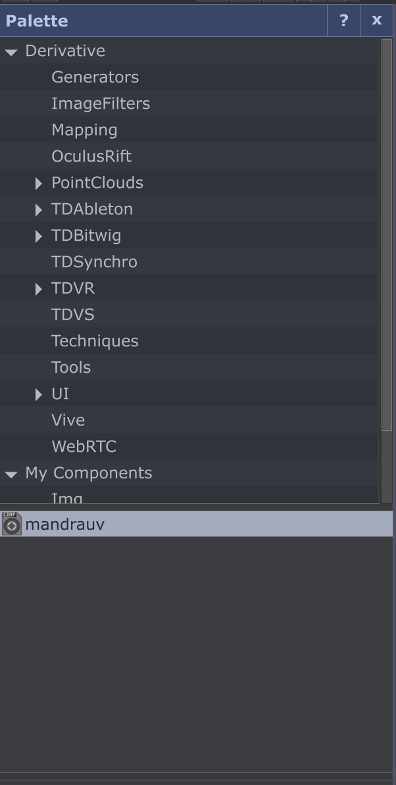
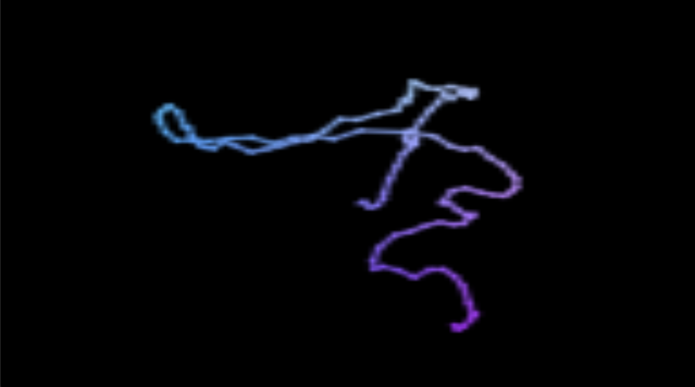
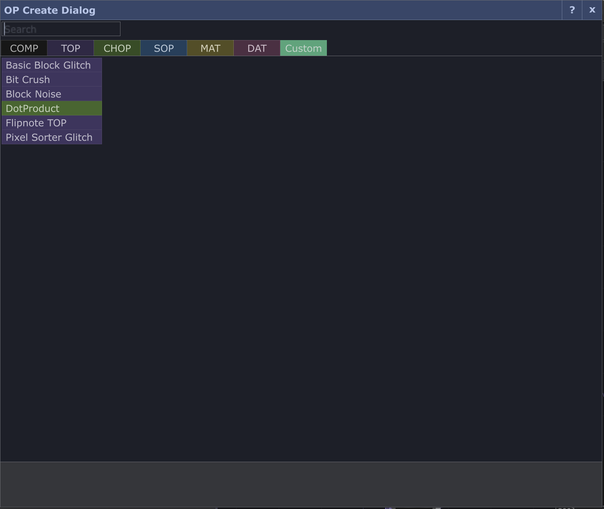
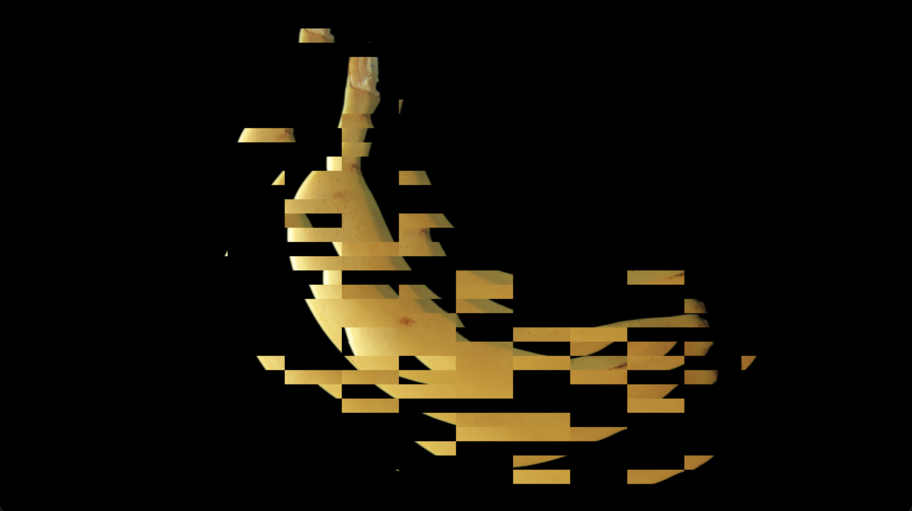
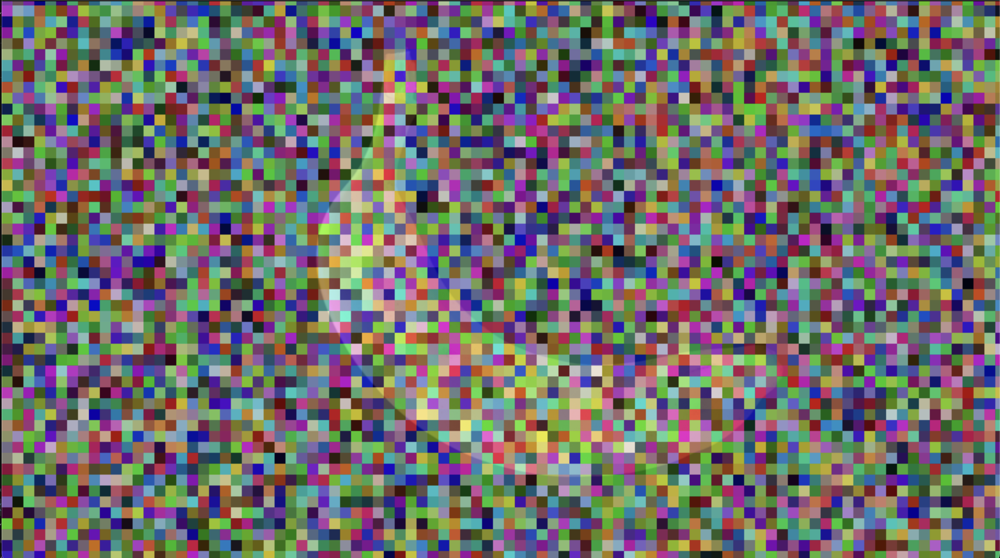
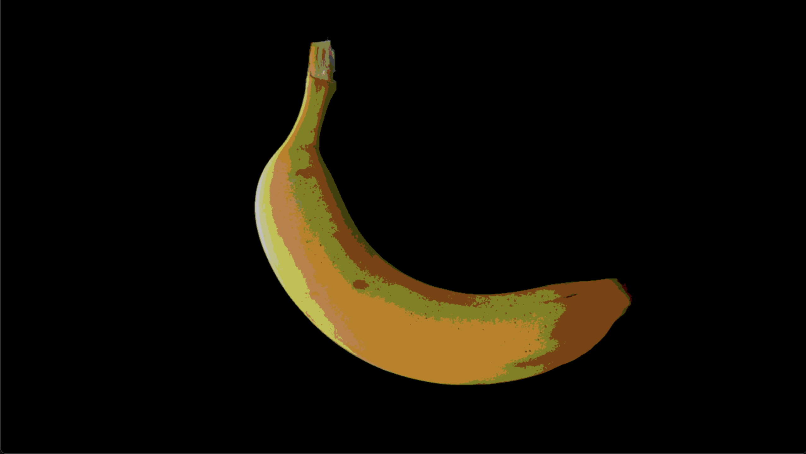
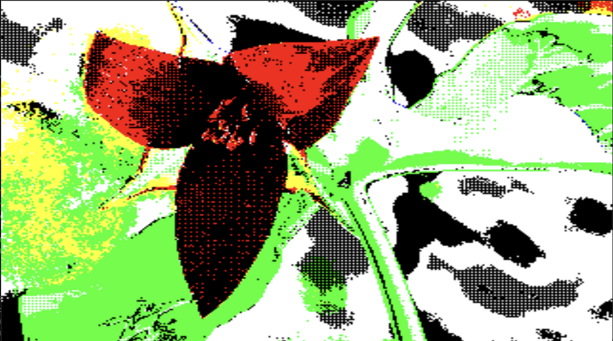
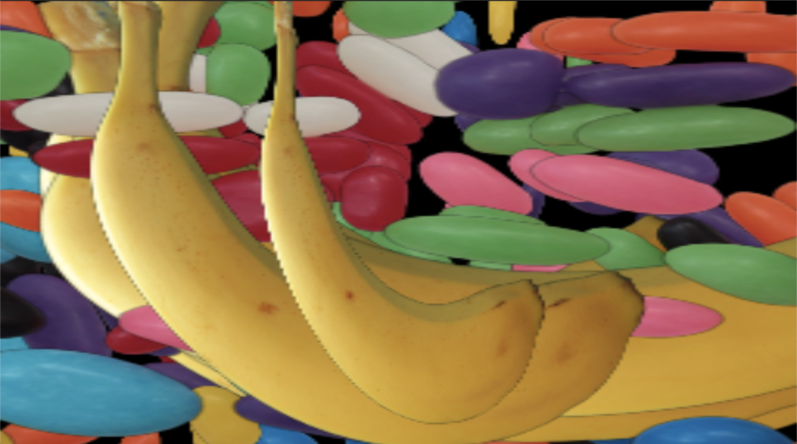

日本語 | [English](./README.en.md)

# Touch Designer Plugins  
自作したTouchDesigner用の追加機能などを置いてます.  

**プラグインのダウンロード・説明・パラメータ一覧はサイトにまとめています → [TouchDesigner Plugins](https://shinh0707.github.io/TouchDesignerShareDatas/)**  
- [Palette](#palette)  
	- [導入](#palette導入)  
	- [説明](#palette説明)  
- [Plugin](#plugin)  
	- [導入](#plugin導入)  
	- [説明](#plugin説明)  
		- [CHOP](#chop)
		- [TOP](#top)
  
## Palette  
TouchDesignerの左側のタブにあるプリセットみたいなやつです.  
  
  
### Palette導入  
[Palettes](Palettes)の中から使いたい`.tox`ファイルを選んでプロジェクト内にDrag＆Dropで使うことができます.  
  
*詳細は[https://derivative.ca/UserGuide/Palette](https://derivative.ca/UserGuide/Palette)を確認してください*  
  
### Palette説明
1. [identifyUV](Palettes/identifyUV.tox)  
	初期状態のUVです.
2. [mandalaUV](Palettes/mandalaUV.tox)  
	曼荼羅模様(シンメトリーな幾何学模様)を簡単に作れるUVです.  
	使用例: [MandalaExample.toe](Projects/MandalaExample.toe)  
3. [pinholeRadtan](Palettes/pinholeRadtan.tox)  
	画像の一部を膨張/縮小するUVです.  
	使用例: [PinholeRadtanExample.toe](Projects/PinholeRadtanExample.toe)  
4. [lineDrawer](Palettes/lineDrawer.tox)  
	CHOPで座標と色を指定して線を描画します.  
	使用例: [LineDrawerExample.toe](Projects/LineDrawerExample.toe "LineDrawerの使用例")  
	  
  
## Plugin  
TouchDesignerのオリジナルノードみたいなやつです.  
上手く導入できるとOperatorの選択ウィンドウの`Custom`タブに追加されます.  
  
  
### Plugin導入  
1. [ダウンロードページ](https://shinh0707.github.io/TouchDesignerShareDatas/downloads/)(または [Releases](https://github.com/Shinh0707/TouchDesignerShareDatas/releases/latest))から、使いたいプラグインの zip を OS に合わせて選びます.  
	全部まとめた `TDPlugins-<version>-<mac|windows>.zip` もあります.  
	新しい版は公開から7日間「様子見中」として表示しています. 急ぎでなければ「おすすめ版」を選んでください.  
2. zip を展開して, 中の `.plugin`(Mac)/ `.dll`(Windows)を次の場所に置きます.  
	- Windows: `Documents/Derivative/Plugins`(`C:/Users/<username>/Documents/Derivative/Plugins`)  
	- Mac: `/Users/<username>/Library/Application Support/Derivative/TouchDesigner099/Plugins`  
3. TouchDesignerを再起動します.  

Mac版・Windows版とも, それぞれの OS 上でビルドし自動テストを通したものです.  
以前このリポジトリの `Plugins` フォルダに置いていた旧版は削除しました(Windows 用の DLL が実際には Mac 用で動かなかったため). 上のダウンロードページから取得してください.  
  
*詳細は[https://docs.derivative.ca/Custom_Operators](https://docs.derivative.ca/Custom_Operators)を確認してください*  
  
### Plugin説明  
#### CHOP
1. [`DotCHOP`](https://shinh0707.github.io/TouchDesignerShareDatas/plugins/DotCHOP/)  
	CHOP同士の内積をとります.  
	使用例: [DotProductCHOPExample.toe](Projects/DotProductCHOPExample.toe "DotProductCHOP使用例")  
2. [`GranularCHOP`](https://shinh0707.github.io/TouchDesignerShareDatas/plugins/GranularCHOP/)
	CHOPに簡易的なグラニュラー効果をかけます.  
	２段階かけるといい感じになります.  
	使用例1: [TouchDesigner Plugin "Granular"](https://youtu.be/0uRVfFLauyg "TouchDesigner Plugin Granular YouTube")  
	使用例2: [GranularCHOPExample.toe](Projects/GranularCHOPExample.toe "GranularCHOP使用例")  
3. [`HistogramCHOP`](https://shinh0707.github.io/TouchDesignerShareDatas/plugins/HistogramCHOP/)  
	CHOPのヒストグラムを計算します.  
	使用例: [HistogramCHOPExample.toe](Projects/HistogramCHOPExample.toe "HistogramCHOP使用例")  
4. [`MIDIFileInCHOP`](https://shinh0707.github.io/TouchDesignerShareDatas/plugins/MidiFileInCHOP/)  
	MIDIファイルを手軽に読めます.(`MIDI In`より機能が少なく、簡単に使えます)  
5. [`SoundFontSynthCHOP`](https://shinh0707.github.io/TouchDesignerShareDatas/plugins/SoundFontSynthCHOP/)  
	SoundFontファイルを再生します.`MIDIFileInCHOP`と一緒に使うことを想定しています.  
6. [`BLEInCHOP`](https://shinh0707.github.io/TouchDesignerShareDatas/plugins/BLEInCHOP/)  
	BLE（Bluetooth Low Energy）デバイスからカンマ区切りの数値列（例: `123,0.5,3.212`）としてフォーマットされた
	ASCII文字列を受信し、それらをCHOPチャンネルとして出力します.  
	[SimpleBLE](https://github.com/simpleble/simpleble)ライブラリを使用しています.(Mac版のみ)
7. [`LifeGameCHOP`](https://shinh0707.github.io/TouchDesignerShareDatas/plugins/LifeGameCHOP/)  
	ライフゲームを動かし, 盤面の各行をチャンネルとして出力します. ランダムな発生・消滅の確率も設定できます.  
8. [`Im2ColCHOP`](https://shinh0707.github.io/TouchDesignerShareDatas/plugins/Im2ColCHOP/) / [`Col2ImCHOP`](https://shinh0707.github.io/TouchDesignerShareDatas/plugins/Col2ImCHOP/)  
	画像状に並べたCHOPの値を, 畳み込み用のパッチ列に並べ替えます(im2col)/ 元に戻します(col2im).  
  
#### TOP
1. [`BasicBlockGlitchTOP`](https://shinh0707.github.io/TouchDesignerShareDatas/plugins/BasicBlockGlitchTOP/)  
	画像をタイル状にバラバラにします. 逐次動かすこともできます.  
	使用例: [BasicBlockGlitchTOPExample.toe](Projects/BasicBlockGlitchTOPExample.toe)  
	  
2. [`BlockNoiseTOP`](https://shinh0707.github.io/TouchDesignerShareDatas/plugins/BlockNoiseTOP/)  
	四角いノイズ乗っけるだけです. `TOP > Noise`でもいいと思います.  
	使用例: [BlockNoiseTOPExample.toe](Projects/BlockNoiseTOPExample.toe)  
	  
3. [`BitCrushTOP`](https://shinh0707.github.io/TouchDesignerShareDatas/plugins/BitCrushTOP/)  
	画像の色をBit単位で量子化します. 古めの映像とかを表現できます.  
	使用例: [BitCrushTOPExample.toe](Projects/BitCrushTOPExample.toe)  
	  
4. [`PixcelSorterGlitchTOP`](https://shinh0707.github.io/TouchDesignerShareDatas/plugins/PixcelSorterGlitchTOP/)  
	Kim Asendorf氏の[ASDFPixelSort](https://github.com/kimasendorf/ASDFPixelSort)を参考に, PixcelSortingをTouchDesignerのプラグイン化したものです.(Black,Brightness,R,G,B,RGBMaxのモードを選択できます)  
	使用例: [PixcelSorterGlitchTOPExample.toe](Projects/PixcelSorterGlitchTOPExample.toe)  
	  
5. [`FlipnoteTOP`](https://shinh0707.github.io/TouchDesignerShareDatas/plugins/FlipnoteTOP/)  
	画質・アスペクト比・画像コンテンツを「うごくメモ帳」風にします. DSi/3DS版を選べます.  
	参考程度に, DitherLevelsを動かすと点々の密度, DitherLumaThresholdを動かすと鮮やかさが変わり, Edge系パラメータを動かすと輪郭の強調を制御できます. 多くの画像で共通で良い結果が得られるパラメータのセットは見つかってません.  
	Operatorのパラメータ設定画面の`Common > Viewer Smoothness`を`Nearist Pixcel`にすると, 更に見た目が「うごくメモ帳」らしくなります.  
	使用例: [FlipnoteTOPExample.toe](Projects/FlipnoteTOPExample.toe)  
	
6. [`InstanceTOP`](https://shinh0707.github.io/TouchDesignerShareDatas/plugins/InstanceTOP/)  
	入力画像を複製してCHOPで変形して重ねるプラグイン.  
	使用例: [InstanceTOPExample.toe](Projects/InstanceTOPExample.toe)  
	