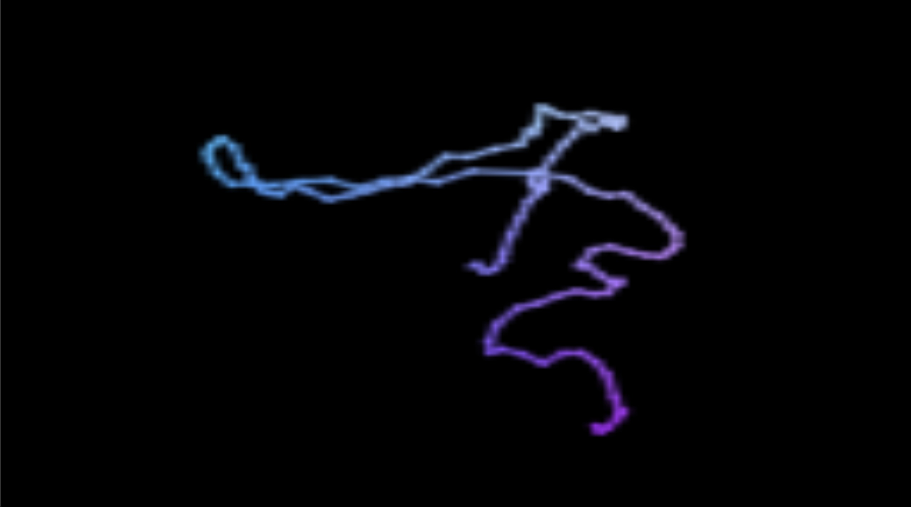

<!-- https://shinh0707.github.io/TouchDesignerShareDatas/palettes/UV/lineDrawer/ -->

# lineDrawer

`UV` フォルダのパレットです。

## 説明

点列 CHOP を折れ線として画像の上に描く（GLSL）。Start〜End で線全体の長さのどの区間を描くかを決めるので、0→1 にアニメーションすると線が伸びていく。各線分は、始点の色から終点の色へのグラデーションで描く（色は colors CHOP の各サンプル）。太さ・長さはピクセルで測るので、横長の画像でも縦と横で同じ太さになる。

入力

- img: 背景の TOP（出力の解像度もこれ）。省略時は 128×128 の黒
- points: 点列の CHOP（x, y チャンネル、UV 0〜1、サンプル = 頂点、最大 10000）
- colors: 色の CHOP（r, g, b, a チャンネル、サンプル = 頂点）。省略時は白

出力: out1 線を描いた画像（img と同じ解像度）

パラメータ

- Start / End: 描く区間（全長に対する割合 0〜1）
- Thickness: 線の太さ（px）

## ダウンロード

[lineDrawer.tox をダウンロード](https://github.com/Shinh0707/TouchDesignerShareDatas/raw/main/Palettes/UV/lineDrawer.tox) [使用例 lineDrawerExample.toe](https://github.com/Shinh0707/TouchDesignerShareDatas/raw/main/Palettes/UV/lineDrawerExample.toe)

`.tox` はネットワークにドラッグ & ドロップするか、Palette の My Components に入れて使います([使い方](https://shinh0707.github.io/TouchDesignerShareDatas/palettes/))。

## 入力と出力

| | 種類 | 名前 | 内容 |
|---|---|---|---|
| 入力 0 | TOP | `img` | Image / 背景。出力の解像度(省略可) |
| 入力 1 | CHOP | `points` | Vector / x と y（UV 0〜1）, accept: [0, 1] |
| 入力 2 | CHOP | `colors` | Vector / r g b a(省略可) |
| 出力 0 | TOP | `out1` | Image |

## パラメータ

| Name | Label | Page | Type | Default | Menu / Range |
|---|---|---|---|---|---|
| `Start` | Start | Parameters | Float | `0` | 0.0 … 1.0 |
| `End` | End | Parameters | Float | `1` | 0.0 … 1.0 |
| `Thickness` | Thickness | Parameters | Float | `1` | 0.0 … 20.0 |

## 使用例

### ノイズで描く線


Noise CHOP の 300 点を折れ線として黒い背景に描きます。色も Noise CHOP で点ごとに変えています。
End を 0→1 にアニメーションすると、線が伸びていく演出になります。

ネットワーク: `constant1` (constantTOP: `resolutionw=720`, `resolutionh=720`, `colorr=0`, `colorg=0`, `colorb=0`) → `noise1` (noiseCHOP: `channelname=x y`, `startunit=samples`, `start=0`, `endunit=samples`, `end=299`, `amp=0.4`, `offset=0.5`, `period=0.6`) → `noise2` (noiseCHOP: `channelname=r g b a`, `startunit=samples`, `start=0`, `endunit=samples`, `end=299`, `amp=0.5`, `offset=0.6`, `seed=4`) → `lineDrawer` (パレット: `Thickness=4`) → `out1`

[lineDrawerExample.toe をダウンロード](https://github.com/Shinh0707/TouchDesignerShareDatas/raw/main/Palettes/UV/lineDrawerExample.toe)

??? note "手順(UV/lineDrawer.example.py)"

    ```python
    """ノイズで描く線

    Noise CHOP の 300 点を折れ線として黒い背景に描きます。色も Noise CHOP で点ごとに変えています。
    End を 0→1 にアニメーションすると、線が伸びていく演出になります。
    """

    def build(ex, tox):
        bg = ex.op("constantTOP", x=-440, y=0, resolutionw=720, resolutionh=720, colorr=0, colorg=0, colorb=0)
        pts = ex.op("noiseCHOP", x=-440, y=-150, channelname="x y", startunit="samples", start=0, endunit="samples",
                    end=299, amp=0.4, offset=0.5, period=0.6)
        cols = ex.op("noiseCHOP", x=-440, y=-300, channelname="r g b a", startunit="samples", start=0,
                     endunit="samples", end=299, amp=0.5, offset=0.6, seed=4)
        ex.palette(tox, bg, pts, cols, Thickness=4)
    ```

TouchDesigner で読み込んでエラーが出ないことを確認済み(2026-11-27)。

## 依存プラグイン

このパレットは TouchDesigner 標準のオペレータだけでできています。追加のプラグインは要りません。

## ほかの使用例

- [LineDrawerExample.toe](https://github.com/Shinh0707/TouchDesignerShareDatas/raw/main/Projects/LineDrawerExample.toe)(手作りのサンプルプロジェクト)



20 個のオペレータ。sha256: `557762b0a6a1ffe7…`
