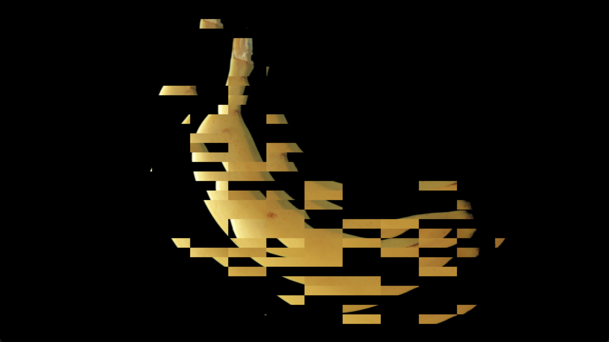

<!-- https://shinh0707.github.io/TouchDesignerShareDatas/plugins/BasicBlockGlitchTOP/ -->

# Basic Block Glitch (BasicBlockGlitchTOP)

## 概要

画像をタイル状にバラバラにします. 逐次動かすこともできます.
使用例: [BasicBlockGlitchTOPExample.toe](https://github.com/Shinh0707/TouchDesignerShareDatas/blob/main/Projects/BasicBlockGlitchTOPExample.toe)


## リファレンス

| 項目 | 値 |
|---|---|
| OP Type | `Basicblockglitch` |
| ラベル | Basic Block Glitch |
| 種類 | TOP |
| 入力数 | 1 – 1 |
| バージョン | 0.1 |
| 作者 | Shinh0707 |
| Execute mode | CPUMem |

### ダウンロード

[リリース一覧](https://github.com/Shinh0707/TouchDesignerShareDatas/releases?q=BasicBlockGlitchTOP)

### 処理時間

| ケース | 入力 | Mac<br>Apple M4 Pro | Windows<br>AMD Ryzen 9 7940HS w/ Radeon 780M Graphics |
|---|---|---|---|
| 1080p | TOP 1920x1080 | 0.290 ms<br>60→59.0 fps | 0.936 ms<br>60→56.8 fps 🔻 |
| default | TOP 1280x720 | 0.105 ms<br>60→59.6 fps | 0.418 ms<br>60→58.5 fps |

cook 1 回の中央値(Release ビルド、TouchDesigner 外での CPU 処理時間)。「60→N fps」は、フレームに余裕の無い 60 fps のプロジェクトに足したときのフレームレート(最悪の場合)。🔻 は 2 fps 以上落ちるケース。計測日: Mac 2026-11-27, Windows 2026-11-27。⚠ はその入力でエラー表示が出たケース。
### 使用例

どれもダウンロードした zip に `.toe` で入っていて、プラグインと同じフォルダにあればインストールしなくても開けます。ネットワークは `BasicBlockGlitchTOP` の `examples/` にある手順(Python)から自動で作っています。

#### 写真のブロックをずらす


16×8 ピクセルのブロックのうち 3 割を、左右に最大 40 ピクセルずれた場所の絵で置き換えます。
Animate をオフにしているので、Seed を変えない限り同じ崩れ方のままです。

ネットワーク: `in0` (moviefileinTOP: `outputresolution=half`) → `plugin` (CPlusPlus TOP: `Blocksize=[16, 8]`, `Shift=[40, 0]`, `Threshold=0.3`, `Seed=3`, `Animate=False`) → `out1`

TouchDesigner 099.2025.33230(macOS)で開いて確認済み(2026-11-27)。TD 上の処理時間 **0.475 ms** — 余裕の無い 60 fps のプロジェクトなら **58.3 fps**(-1.7)。

ファイル: `BasicBlockGlitchTOPExample.toe`

??? note "手順(examples/default.py)"

    ```python
    """写真のブロックをずらす

    16×8 ピクセルのブロックのうち 3 割を、左右に最大 40 ピクセルずれた場所の絵で置き換えます。
    Animate をオフにしているので、Seed を変えない限り同じ崩れ方のままです。
    """

    def build(ex):
        img = ex.input("moviefileinTOP", outputresolution="half")   # 640×360: CPU で処理する TOP は、画素数に比例して GPU との受け渡しに時間がかかります
        ex.plugin(img, Blocksize=(16, 8), Shift=(40, 0), Threshold=0.3, Seed=3, Animate=False)
    ```

### パラメータ: (no page)

| Name | Label | Type | Default | Range / Menu | Slider |
|---|---|---|---|---|---|
| `Blocksize` | Block Size | XY | (16, 16) | (1, 1) … ∞ | (1, 1) … (128, 128) |
| `Shift` | Shift | XY | (50, 50) | −∞ … ∞ | (0, 0) … (1000, 1000) |
| `Threshold` | Threshold | Float | 0.1 | −∞ … ∞ | 0 … 1 |
| `Seed` | Seed | Int | 0 | −∞ … ∞ | 0 … 1000 |
| `Animate` | Animate | Toggle | On |  |  |

## 使い方

TOP を 1 つつなぎます。出力は入力と同じ解像度です。

- **Block Size**: ブロックの幅と高さ(ピクセル)。
- **Threshold**: ずらすブロックの割合。0 で何も起きず、1 で全部のブロックがずれます。
- **Shift**: ずらす量の上限(ピクセル)。ブロックごとに −Shift〜+Shift の範囲でランダムに決まります。
  横だけ崩したいときは Y を 0 にします。ずれた先が画面の外になるときは、端のピクセルを使います。
- **Animate**: オンだと cook のたびに崩れ方が変わります。オフだと **Seed** で決まる 1 つの崩れ方のままです。

!!! note
    画素を CPU で処理します(8 bit RGBA に変換して読み出し)。大きな解像度では重くなるので、
    下の処理時間を目安に、必要なら手前で解像度を下げてください。
