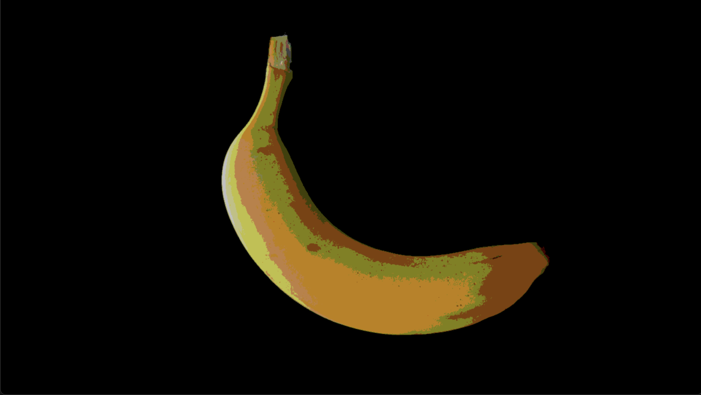

<!-- https://shinh0707.github.io/TouchDesignerShareDatas/plugins/BitCrushTOP/ -->

# Bit Crush (BitCrushTOP)

## 概要

画像の色をBit単位で量子化します. 古めの映像とかを表現できます.
使用例: [BitCrushTOPExample.toe](https://github.com/Shinh0707/TouchDesignerShareDatas/blob/main/Projects/BitCrushTOPExample.toe)


## リファレンス

| 項目 | 値 |
|---|---|
| OP Type | `Bitcrush` |
| ラベル | Bit Crush |
| 種類 | TOP |
| 入力数 | 1 – 1 |
| バージョン | 0.1 |
| 作者 | Shinh0707 |
| Execute mode | CPUMem |

### ダウンロード

[リリース一覧](https://github.com/Shinh0707/TouchDesignerShareDatas/releases?q=BitCrushTOP)

### 処理時間

| ケース | 入力 | Mac<br>Apple M4 Pro | Windows<br>AMD Ryzen 9 7940HS w/ Radeon 780M Graphics |
|---|---|---|---|
| 1080p | TOP 1920x1080 | 0.100 ms<br>60→59.6 fps | 0.266 ms<br>60→59.1 fps |
| 720p | TOP 1280x720 | 0.060 ms<br>60→59.8 fps | 0.116 ms<br>60→59.6 fps |

cook 1 回の中央値(Release ビルド、TouchDesigner 外での CPU 処理時間)。「60→N fps」は、フレームに余裕の無い 60 fps のプロジェクトに足したときのフレームレート(最悪の場合)。🔻 は 2 fps 以上落ちるケース。計測日: Mac 2026-11-27, Windows 2026-11-27。⚠ はその入力でエラー表示が出たケース。
### 使用例

どれもダウンロードした zip に `.toe` で入っていて、プラグインと同じフォルダにあればインストールしなくても開けます。ネットワークは `BitCrushTOP` の `examples/` にある手順(Python)から自動で作っています。

#### 写真にビットクラッシュ


TD 付属のバナナ画像に、既定の 4 ビット / 色をかけたものです。なめらかなグラデーションが縞になります。

ネットワーク: `in0` (moviefileinTOP: `outputresolution=half`) → `plugin` (CPlusPlus TOP) → `out1`

TouchDesigner 099.2025.33230(macOS)で開いて確認済み(2026-11-27)。TD 上の処理時間 **0.311 ms** — 余裕の無い 60 fps のプロジェクトなら **58.9 fps**(-1.1)。

ファイル: `BitCrushTOPExample.toe`

??? note "手順(examples/default.py)"

    ```python
    """写真にビットクラッシュ

    TD 付属のバナナ画像に、既定の 4 ビット / 色をかけたものです。なめらかなグラデーションが縞になります。
    """

    def build(ex):
        img = ex.input("moviefileinTOP", outputresolution="half")   # 640×360: CPU で処理する TOP は、画素数に比例して GPU との受け渡しに時間がかかります
        ex.plugin(img)
    ```

#### 1 色あたり 2 ビット


各チャンネル 4 段階だけになり、ポスターのような強い見た目になります。

ネットワーク: `in0` (moviefileinTOP: `outputresolution=half`) → `plugin` (CPlusPlus TOP: `Bitspercolor=2`) → `out1`

TouchDesigner 099.2025.33230(macOS)で開いて確認済み(2026-11-27)。TD 上の処理時間 **0.342 ms** — 余裕の無い 60 fps のプロジェクトなら **58.8 fps**(-1.2)。

ファイル: `BitCrushTOPExample_two_bits.toe`

??? note "手順(examples/two_bits.py)"

    ```python
    """1 色あたり 2 ビット

    各チャンネル 4 段階だけになり、ポスターのような強い見た目になります。
    """

    def build(ex):
        img = ex.input("moviefileinTOP", outputresolution="half")   # 640×360: CPU で処理する TOP は、画素数に比例して GPU との受け渡しに時間がかかります
        ex.plugin(img, Bitspercolor=2)
    ```

**TouchDesigner テスト: 3 / 3 件合格**(test_eight_bits_is_identity, test_keeps_input_resolution, test_two_bits_gives_four_levels)

### パラメータ: BitCrush

| Name | Label | Type | Default | Range / Menu | Slider |
|---|---|---|---|---|---|
| `Bitspercolor` | Bits per Color | Int | 4 | 1 … 8 | 1 … 8 |
| `Multithreaded` | Multithreaded | Toggle | Off |  |  |

## 使い方

TOP を 1 つつなぎます。出力は入力と同じ解像度です。

- **Bits per Color**: R・G・B それぞれを何ビットで表すか。8 で変化なし、4 で 16 段階、2 で 4 段階、1 で 2 段階(8 色)です。
  下位のビットを切り捨てるだけなので、絵は少し暗くなります(2 ビットなら最大でも 192/255)。アルファはそのままです。
- **Multithreaded**: オンにすると別スレッドで処理し、TD は結果を待ちません。出力は数フレーム遅れますが、
  大きな画像でも TD のフレームレートを落としません。

なめらかなグラデーションほど縞(バンディング)がはっきり出ます。手前で Level TOP などで明るさを動かすと縞が流れます。
