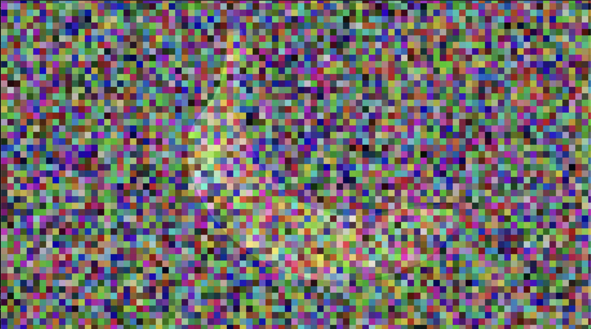

<!-- https://shinh0707.github.io/TouchDesignerShareDatas/plugins/BlockNoiseTOP/ -->

# Block Noise (BlockNoiseTOP)

## 概要

四角いノイズ乗っけるだけです. `TOP > Noise`でもいいと思います.
使用例: [BlockNoiseTOPExample.toe](https://github.com/Shinh0707/TouchDesignerShareDatas/blob/main/Projects/BlockNoiseTOPExample.toe)


## リファレンス

| 項目 | 値 |
|---|---|
| OP Type | `Blocknoise` |
| ラベル | Block Noise |
| 種類 | TOP |
| 入力数 | 1 – 1 |
| バージョン | 0.1 |
| 作者 | Shinh0707 |
| Execute mode | CPUMem |

### ダウンロード

[リリース一覧](https://github.com/Shinh0707/TouchDesignerShareDatas/releases?q=BlockNoiseTOP)

### 処理時間

| ケース | 入力 | Mac<br>Apple M4 Pro | Windows<br>AMD Ryzen 9 7940HS w/ Radeon 780M Graphics |
|---|---|---|---|
| 1080p | TOP 1920x1080 | 0.115 ms<br>60→59.6 fps | 1.04 ms<br>60→56.5 fps 🔻 |
| amount 0 | TOP 1280x720 | 0.049 ms<br>60→59.8 fps | 0.101 ms<br>60→59.6 fps |
| amount 0.5 colour | TOP 1280x720 | 0.166 ms<br>60→59.4 fps | 1.86 ms<br>60→54.0 fps 🔻 |
| default | TOP 1280x720 | 0.078 ms<br>60→59.7 fps | 0.598 ms<br>60→57.9 fps 🔻 |

cook 1 回の中央値(Release ビルド、TouchDesigner 外での CPU 処理時間)。「60→N fps」は、フレームに余裕の無い 60 fps のプロジェクトに足したときのフレームレート(最悪の場合)。🔻 は 2 fps 以上落ちるケース。計測日: Mac 2026-11-27, Windows 2026-11-27。⚠ はその入力でエラー表示が出たケース。
### 使用例

どれもダウンロードした zip に `.toe` で入っていて、プラグインと同じフォルダにあればインストールしなくても開けます。ネットワークは `BlockNoiseTOP` の `examples/` にある手順(Python)から自動で作っています。

#### 写真に色つきのブロックノイズを重ねる


24 ピクセルのブロックごとにランダムな色を作り、元の絵に 4 割だけ混ぜます(Amount = 0.4)。
Monochrome をオンにすると灰色のノイズになります。

ネットワーク: `in0` (moviefileinTOP) → `plugin` (CPlusPlus TOP: `Blocksize=24`, `Amount=0.4`, `Monochrome=False`, `Seed=7`) → `out1`

TouchDesigner 099.2025.33230(macOS)で開いて確認済み(2026-11-27)。TD 上の処理時間 **0.610 ms** — 余裕の無い 60 fps のプロジェクトなら **57.9 fps**(-2.1)。

!!! warning "フレームレートへの影響が大きめです"
    この使用例では 60 fps から 2 fps 以上落ちます。入力の解像度やパラメータに注意してください。

ファイル: `BlockNoiseTOPExample.toe`

??? note "手順(examples/default.py)"

    ```python
    """写真に色つきのブロックノイズを重ねる

    24 ピクセルのブロックごとにランダムな色を作り、元の絵に 4 割だけ混ぜます(Amount = 0.4)。
    Monochrome をオンにすると灰色のノイズになります。
    """

    def build(ex):
        img = ex.input("moviefileinTOP")
        ex.plugin(img, Blocksize=24, Amount=0.4, Monochrome=False, Seed=7)
    ```

### パラメータ: Custom

| Name | Label | Type | Default | Range / Menu | Slider |
|---|---|---|---|---|---|
| `Blocksize` | Block Size | Int | 16 | 1 … ∞ | 1 … 256 |
| `Seed` | Seed | Int | 0 | −∞ … ∞ | 0 … 1000 |
| `Amount` | Amount | Float | 1 | −∞ … ∞ | 0 … 1 |
| `Monochrome` | Monochrome | Toggle | On |  |  |

## 使い方

TOP を 1 つつなぎます。出力は入力と同じ解像度です。

- **Block Size**: ブロックの 1 辺(ピクセル)。
- **Amount**: ノイズを混ぜる割合。0 で元の絵のまま、1 でノイズだけになります。
- **Monochrome**: オンで灰色、オフでブロックごとにランダムな色になります。
- **Seed**: ノイズの並び。動かしたいときは `absTime.frame` などの式を入れます(自動では変わりません)。

アルファは元の絵のままです。
