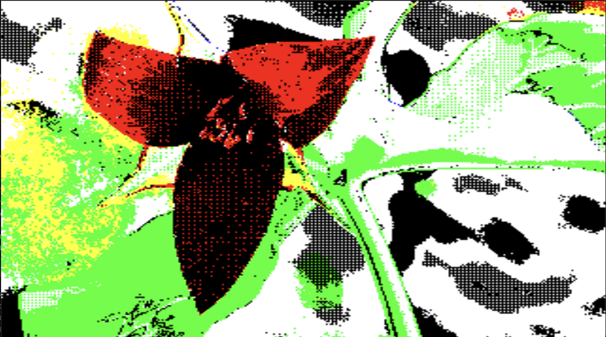

<!-- https://shinh0707.github.io/TouchDesignerShareDatas/plugins/FlipnoteTOP/ -->

# Flipnote TOP (FlipnoteTOP)

## 概要

画質・アスペクト比・画像コンテンツを「うごくメモ帳」風にします. DSi/3DS版を選べます.
参考程度に, DitherLevelsを動かすと点々の密度, DitherLumaThresholdを動かすと鮮やかさが変わり, Edge系パラメータを動かすと輪郭の強調を制御できます. 多くの画像で共通で良い結果が得られるパラメータのセットは見つかってません.
Operatorのパラメータ設定画面の`Common > Viewer Smoothness`を`Nearist Pixcel`にすると, 更に見た目が「うごくメモ帳」らしくなります.
使用例: [FlipnoteTOPExample.toe](https://github.com/Shinh0707/TouchDesignerShareDatas/blob/main/Projects/FlipnoteTOPExample.toe)


## リファレンス

| 項目 | 値 |
|---|---|
| OP Type | `Flipnotetop` |
| ラベル | Flipnote TOP |
| 種類 | TOP |
| 入力数 | 1 – 1 |
| バージョン | 0.1 |
| 作者 | Shinh0707 |
| Execute mode | CPUMem |

### ダウンロード

[リリース一覧](https://github.com/Shinh0707/TouchDesignerShareDatas/releases?q=FlipnoteTOP)

### 処理時間

| ケース | 入力 | Mac<br>Apple M4 Pro | Windows<br>AMD Ryzen 9 7940HS w/ Radeon 780M Graphics |
|---|---|---|---|
| 1080p 3DS | TOP 1920x1080 | 0.407 ms<br>60→58.6 fps | 2.25 ms<br>60→52.9 fps 🔻 |
| default | TOP 1280x720 | 0.198 ms<br>60→59.3 fps | 1.25 ms<br>60→55.8 fps 🔻 |

cook 1 回の中央値(Release ビルド、TouchDesigner 外での CPU 処理時間)。「60→N fps」は、フレームに余裕の無い 60 fps のプロジェクトに足したときのフレームレート(最悪の場合)。🔻 は 2 fps 以上落ちるケース。計測日: Mac 2026-11-27, Windows 2026-11-27。⚠ はその入力でエラー表示が出たケース。
### 使用例

どれもダウンロードした zip に `.toe` で入っていて、プラグインと同じフォルダにあればインストールしなくても開けます。ネットワークは `FlipnoteTOP` の `examples/` にある手順(Python)から自動で作っています。

#### 写真を DSi 版の見た目にする


出力は 256×192 ピクセルで、色は白・黒・赤・青だけになります。中間の明るさは点の密度(ディザ)で表します。

ネットワーク: `in0` (moviefileinTOP: `outputresolution=quarter`) → `plugin` (CPlusPlus TOP) → `out1`

TouchDesigner 099.2025.33230(macOS)で開いて確認済み(2026-11-27)。TD 上の処理時間 **0.531 ms** — 余裕の無い 60 fps のプロジェクトなら **58.1 fps**(-1.9)。

ファイル: `FlipnoteTOPExample.toe`

??? note "手順(examples/default.py)"

    ```python
    """写真を DSi 版の見た目にする

    出力は 256×192 ピクセルで、色は白・黒・赤・青だけになります。中間の明るさは点の密度(ディザ)で表します。
    """

    def build(ex):
        img = ex.input("moviefileinTOP", outputresolution="quarter")   # 320×180: 出力が 256×192 / 320×240 なので、入力はこれで足ります
        ex.plugin(img)
    ```

#### 3DS 版の見た目にする


3DS Mode をオンにすると、出力が 320×240 ピクセルになり、緑と黄も使えるようになります。

ネットワーク: `in0` (moviefileinTOP: `outputresolution=quarter`) → `plugin` (CPlusPlus TOP: `Threeds=True`) → `out1`

TouchDesigner 099.2025.33230(macOS)で開いて確認済み(2026-11-27)。TD 上の処理時間 **0.550 ms** — 余裕の無い 60 fps のプロジェクトなら **58.1 fps**(-1.9)。

ファイル: `FlipnoteTOPExample_threeds.toe`

??? note "手順(examples/threeds.py)"

    ```python
    """3DS 版の見た目にする

    3DS Mode をオンにすると、出力が 320×240 ピクセルになり、緑と黄も使えるようになります。
    """

    def build(ex):
        img = ex.input("moviefileinTOP", outputresolution="quarter")   # 320×180: 出力が 256×192 / 320×240 なので、入力はこれで足ります
        ex.plugin(img, Threeds=True)
    ```

### パラメータ: Flipnote

| Name | Label | Type | Default | Range / Menu | Slider |
|---|---|---|---|---|---|
| `Threeds` | 3DS Mode | Toggle | Off |  |  |
| `Blackthreshold` | Black Threshold | Float | 0.13 | −∞ … ∞ | 0 … 1 |
| `Whitethreshold` | White Threshold | Float | 0.72 | −∞ … ∞ | 0 … 1 |
| `Ditherpage` | Dither | Header |  |  |  |
| `Brightnesslevels` | Dither Levels | Int | 5 | 1 … 10 | 1 … 10 |
| `Ditherthreshold` | Dither Luma Threshold | Float | 0.5 | −∞ … ∞ | 0 … 1 |
| `Edgepage` | Edge | Header |  |  |  |
| `Edgeminthreshold` | Edge Min Threshold | Float | 0.08 | −∞ … ∞ | 0 … 1 |
| `Edgemaxthreshold` | Edge Max Threshold | Float | 0.3 | −∞ … ∞ | 0 … 1 |

### 出典・参考

- Wikipedia. [うごくメモ帳](https://ja.wikipedia.org/wiki/うごくメモ帳). Wikipedia 日本語版. — 見た目のもと。DSi 版は 256×192 で黒・白・赤・青、3DS 版は 320×240 で色が増える。任天堂の製品で、このプラグインは公式のものではありません

[すべての出典・参考](https://shinh0707.github.io/TouchDesignerShareDatas/palettes/references/)

## 使い方

TOP を 1 つつなぎます。出力の解像度は固定で、DSi 版が 256×192、**3DS Mode** をオンにすると 320×240 です。
入力の縦横比が違うと引き伸ばされるので、手前で 4:3 に切り出しておくときれいです。

- **Black Threshold / White Threshold**: これより暗い部分は黒、これより明るい部分は白に塗りつぶします。
  2 つの間の明るさが、色と点(ディザ)で表されます。
- **Dither Levels**: 点の間隔の段階数。大きいほど、明るさの違いが点の密度の違いとして細かく出ます。
- **Dither Luma Threshold**: 点の地の色を切り替える明るさ。動かすと全体の鮮やかさが変わります。
- **Edge Min / Max Threshold**: 左隣のピクセルとの色の差がこの範囲に入るところを輪郭として描きます。

多くの画像でうまくいくパラメータの組は見つかっていないので、絵に合わせて調整してください。
OP の **Common > Viewer Smoothness** を *Nearest Pixel* にすると、ドットがはっきりして、より「うごくメモ帳」らしくなります。
