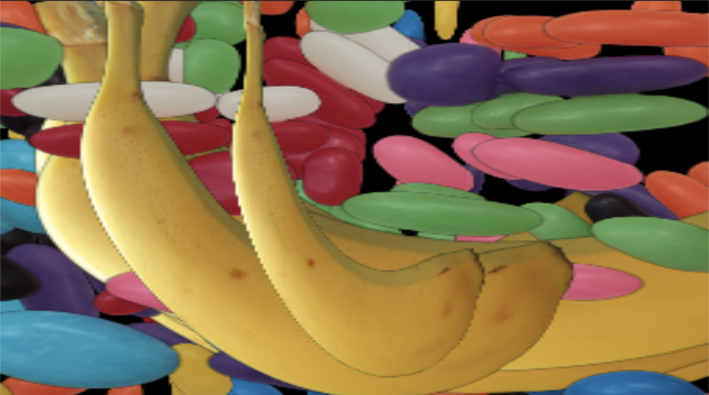

<!-- https://shinh0707.github.io/TouchDesignerShareDatas/plugins/InstanceTOP/ -->

# Instance TOP (InstanceTOP)

## 概要

入力画像を複製してCHOPで変形して重ねるプラグイン.
使用例: [InstanceTOPExample.toe](https://github.com/Shinh0707/TouchDesignerShareDatas/blob/main/Projects/InstanceTOPExample.toe)


## リファレンス

| 項目 | 値 |
|---|---|
| OP Type | `Instance` |
| ラベル | Instance TOP |
| 種類 | TOP |
| 入力数 | 0 – 16 |
| バージョン | 0.1 |
| 作者 | Shinh0707 |
| Execute mode | CPUMem |

### ダウンロード

[リリース一覧](https://github.com/Shinh0707/TouchDesignerShareDatas/releases?q=InstanceTOP)

### 処理時間

| ケース | 入力 | Mac<br>Apple M4 Pro | Windows<br>AMD Ryzen 9 7940HS w/ Radeon 780M Graphics |
|---|---|---|---|
| 100 inst | TOP 1280x720 | 7.07 ms<br>60→42.1 fps 🔻 | 18.20 ms<br>60→28.7 fps 🔻 |
| 1000 inst | TOP 1280x720 | 71.19 ms<br>60→11.4 fps 🔻 | 202 ms<br>60→4.6 fps 🔻 |
| 1000 small inst | TOP 48x48 | 1.71 ms<br>60→54.4 fps 🔻 | 8.83 ms<br>60→39.2 fps 🔻 |

cook 1 回の中央値(Release ビルド、TouchDesigner 外での CPU 処理時間)。「60→N fps」は、フレームに余裕の無い 60 fps のプロジェクトに足したときのフレームレート(最悪の場合)。🔻 は 2 fps 以上落ちるケース。計測日: Mac 2026-11-27, Windows 2026-11-27。⚠ はその入力でエラー表示が出たケース。
### 使用例

どれもダウンロードした zip に `.toe` で入っていて、プラグインと同じフォルダにあればインストールしなくても開けます。ネットワークは `InstanceTOP` の `examples/` にある手順(Python)から自動で作っています。

#### CHOP で動かすインスタンス


入力画像を 8 個描き、Noise CHOP(ランダム)で位置(0〜1、0.5 が中央)・大きさ・回転を与えています。
Position / Scale / Rotation / Index は CHOP を指定するパラメータです。

ネットワーク: `in0` (moviefileinTOP) → `noise1` (noiseCHOP: `channelname=tx ty`, `startunit=samples`, `start=0`, `endunit=samples`, `end=7`, `type=random`, `amp=0.35`, `offset=0.5`) → `noise2` (noiseCHOP: `channelname=sx sy`, `startunit=samples`, `start=0`, `endunit=samples`, `end=7`, `type=random`, `amp=0.1`, `offset=0.3`, `seed=5`) → `noise3` (noiseCHOP: `channelname=r`, `startunit=samples`, `start=0`, `endunit=samples`, `end=7`, `type=random`, `amp=180`, `seed=9`) → `plugin` (CPlusPlus TOP: `Position=noise1`, `Scale=noise2`, `Rotation=noise3`, `Resolution=[512, 512]`) → `out1`

TouchDesigner 099.2025.33230(macOS)で開いて確認済み(2026-11-27)。TD 上の処理時間 **1.385 ms** — 余裕の無い 60 fps のプロジェクトなら **55.4 fps**(-4.6)。

!!! warning "フレームレートへの影響が大きめです"
    この使用例では 60 fps から 2 fps 以上落ちます。入力の解像度やパラメータに注意してください。

ファイル: `InstanceTOPExample.toe`

??? note "手順(examples/default.py)"

    ```python
    """CHOP で動かすインスタンス

    入力画像を 8 個描き、Noise CHOP(ランダム)で位置(0〜1、0.5 が中央)・大きさ・回転を与えています。
    Position / Scale / Rotation / Index は CHOP を指定するパラメータです。
    """

    def build(ex):
        img = ex.input("moviefileinTOP")
        pos = ex.source("noiseCHOP", channelname="tx ty", startunit="samples", start=0, endunit="samples", end=7,
                        type="random", amp=0.35, offset=0.5)
        scale = ex.source("noiseCHOP", channelname="sx sy", startunit="samples", start=0, endunit="samples", end=7,
                          type="random", amp=0.1, offset=0.3, seed=5)
        rot = ex.source("noiseCHOP", channelname="r", startunit="samples", start=0, endunit="samples", end=7,
                        type="random", amp=180, seed=9)
        ex.plugin(img, Position=pos, Scale=scale, Rotation=rot, Resolution=(512, 512))
    ```

### パラメータ: Instance

| Name | Label | Type | Default | Range / Menu | Slider |
|---|---|---|---|---|---|
| `Resolution` | Resolution | WH | (256, 256) | (1, 1) … ∞ | (0, 0) … (1, 1) |
| `Scale` | Scale | CHOP |  |  |  |
| `Position` | Position | CHOP |  |  |  |
| `Rotation` | Rotation | CHOP |  |  |  |
| `Index` | Index | CHOP |  |  |  |

## 使い方

入力の TOP を、CHOP で指定した位置・大きさ・回転で何個も描いて 1 枚に重ねます。出力は **Resolution** の大きさで、背景は透明です。

- 描く個数は、指定した CHOP の**サンプル数**(複数指定したときは一番短いもの)です。1 サンプルが 1 個に当たります。
  CHOP を 1 つも指定しないと何も描きません。
- **Position**: 1 チャンネル目が x、2 チャンネル目が y。出力に対する 0〜1 の割合で、(0.5, 0.5) が中央です。指定しないと全部が中央に重なります。
- **Scale**: 1 チャンネル目が横、2 チャンネル目が縦の倍率(1 チャンネルだけなら縦横同じ)。**1 で入力の TOP のピクセル数そのまま**の大きさです。
- **Rotation**: 1 チャンネル目が回転(度)。
- **Index**: 入力を複数つないだとき、何番目の入力を描くか(0 始まり。負の値は後ろから)。指定しないと全部 1 番目の入力です。
- 入力は 16 個までつなげます。サンプルの順に重ねるので、後のサンプルほど手前になります。アルファ付きの絵は透けて重なります。

!!! note
    重ねる処理は CPU で行います。個数 × 描く面積に比例して重くなるので、たくさん描くときは Resolution と Scale を小さめにします。
